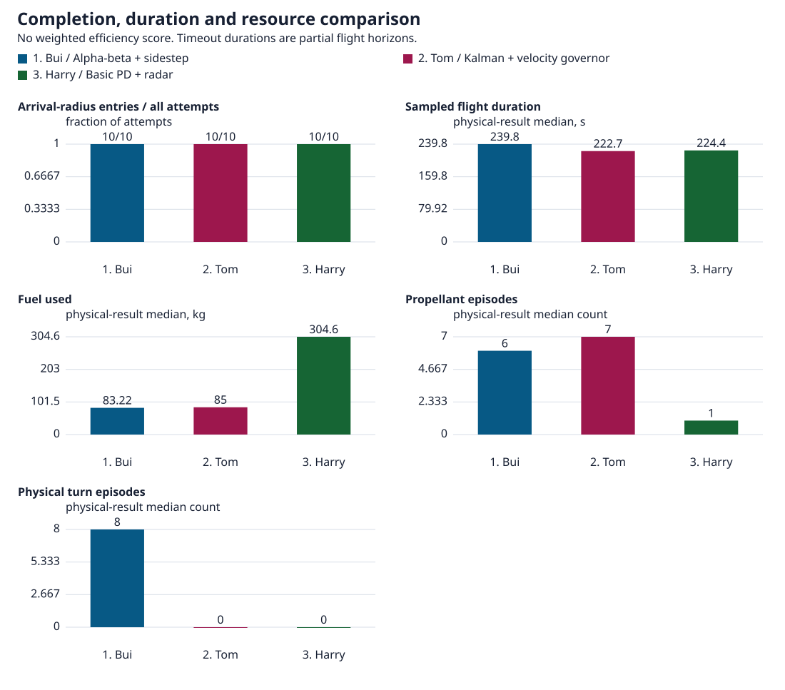
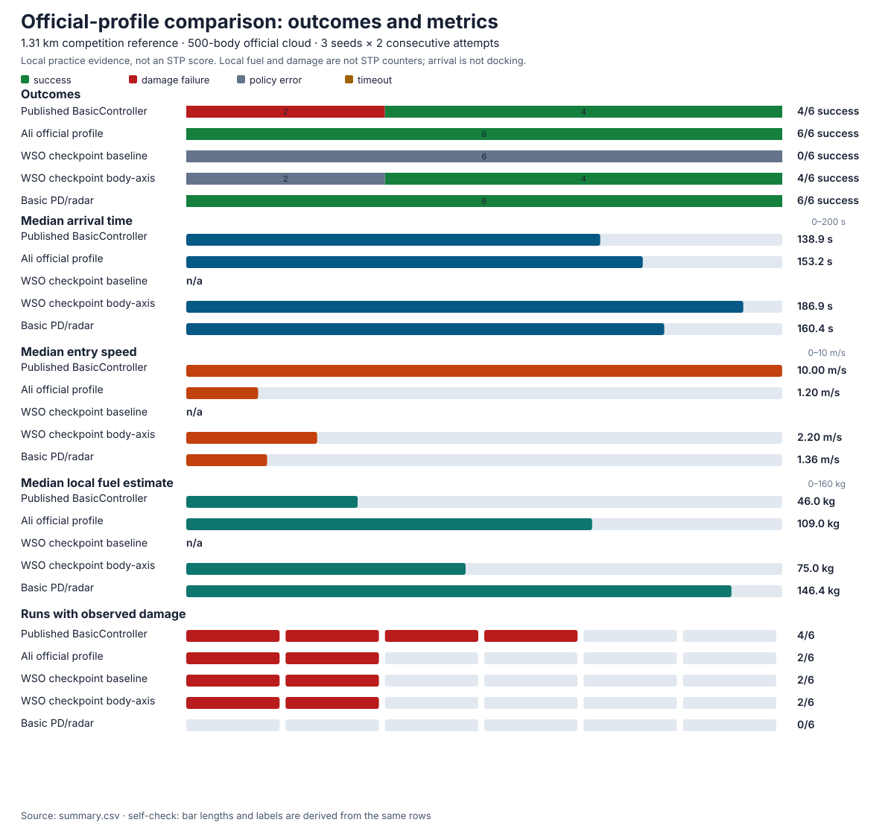

# Western Sydney Orbital

Our team's flight lab for **Escape from Phobos**, the Fall 2026 Space Teams PRO challenge. The goal is to get a shuttle from Phobos to the return ship through impact debris. Use it for manual practice and controller experiments that teammates can repeat.

This is a practice simulator. It does not reproduce Space Teams PRO exactly, so test promising controllers in the licensed competition simulator.

- [Official competition reference](#official-competition-reference)
- [Official-profile comparison](#official-profile-comparison)
- [Start locally](#start-locally)
- [Fly manually](#fly-manually)
- [Run a controller](#run-a-controller)
- [Experiment and compare](#experiment-and-compare)
- [Get help and competition references](#help-and-competition)

## Official competition reference

The **Competition reference · 1.31 km hop** preset and **Official debris cloud** mode port the Fall 2026 Escape from Phobos geometry. They are a local implementation, not an STP-certified reproduction.

| Official value | STU4 source |
| --- | --- |
| 500 debris bodies in a ±300 m × ±300 m × ±500 m cloud, centred 500 m above the lander along local up; seed 100 | [`SpawnDebris.py`][spawn], [`COMPETITION_SIM.simconf`][simconf] |
| 0.40–0.80 m/s tangential drift (0.05–0.10 of orbital speed) | [`SpawnDebris.py`][spawn] |
| Rock weights 45/35/15/5% for Rock1/Rock2/Rock3/ExplodedTank; radii 0.2–20 m; mass scales with size³ | [`Rock1`][rock1], [`Rock2`][rock2], [`Rock3`][rock3], [`ExplodedTank`][tank] |
| 1305.8 m shuttle-to-target route; 50 m keep-out | [`COMPETITION_SIM.simconf`][simconf] |
| 209,200 J damage threshold; 75.0 kg nominal fuel; 120 s nominal time | [`Scoring.py`][scoring], [`COMPETITION_SIM.simconf`][simconf] |
| 0.5 m/s² and 0.05 rad/s² command caps; radar 200 of 500 bodies with 2 m position, 0.02 m/s range-rate and 5% diameter noise | [`COMPETITION_SIM.simconf`][simconf], [`Radar.py`][radar] |
| Successful-run score = 100 × (120 / T − 2D / 209200 − max(F / 75.0, 0) + 0.5) | [`Scoring.py`][scoring] |

`T` is completion time, `D` is the official accumulated damage counter and `F` is the official fuel counter. The official example controller is a 10 m/s beeline with attitude alignment: [`BasicController.py`][controller].

The 20 m/s **Transit traffic** mode is a custom stress field, not the competition field. Local terrain, launch-site radius, absolute frame, fuel and damage counters still differ from the official mission; local fuel and damage are not official STP counters. No local result is an STP score. See [official reference and local differences](docs/competition-reference.md) before treating a local run as competition evidence.

## Start locally

Install Nix, devenv and Just. From the repository root, use the pinned environment rather than a separate global Rust installation.

```sh
just setup
just build
devenv up lab simulation
```

The first build can take several minutes. Later builds reuse unchanged outputs.

1. Open **http://127.0.0.1:61829/** in a current browser with WebGPU enabled.
2. Wait for the world to appear. Keep one game tab visible and press **F** to follow the lander.
3. Select **Notebook** in the bottom toolbar to open the private Python editor. It normally uses port `2718`; open it through the game rather than sharing its access link.

Leave the processes running while you work. `devenv processes down` stops them. Use `devenv up -d lab simulation` for background operation.

For game-only sessions, Windows, headless physics or startup logs, see [other ways to start](docs/flight-lab.md#other-ways-to-start). Do not start a second server accidentally.

## Fly manually

The world starts paused. Click the scene, then select **Play** or press **P**. Pausing freezes the lander and debris together.

| Key | Action |
| --- | --- |
| P | Play or pause. |
| Space | A fresh press launches from pause; hold for upward thrust. |
| E / Q | Thrust up / down. |
| W / S | Fire front / back nozzle, pushing backward / forward. |
| A / D | Fire left / right nozzle, pushing right / left. |
| F / Shift+F | Follow the lander / frame the selected object. |
| 5 / 6 / 7 | Overview / top ship camera / bottom ship camera. |
| H | Full controls and key bindings. |

Nozzles belong to the lander, not the screen. Releasing a key stops thrust, not velocity or spin. Use opposite thrust to slow down. Drag, wheel or pinch to adjust the view; hold Alt/Option with movement keys to move only the viewing camera.

Use **Flight** for measurements, **Ship** for live hardware inputs, **Debris** for the debris field and **Launch** for placement or a new world. **Views** changes the camera and lighting.

Increasing thrust strength does not fire an engine. Check the clock and last-applied thrust reading when an edit seems to do nothing. The [input and placement guide](docs/flight-lab.md#inputs-and-launch-placement) explains live changes, new-world drafts and moving the launchpad.

## Run a controller

**Automatic flight is not reliable in the 20 m/s transit stress field yet.** With seed 100 and attraction off, default A* guidance failed after 54.75 s and Bui's adapter after 44 s, both from collision damage. Those are stress-field failures, not official-cloud arrival evidence. The older successful flights below used a different debris field.

### From the notebook

1. Open **Flight → Connect / Refresh**. This reads the existing flight and draws guidance; it does not fly the lander.
2. Open **Python policy** to choose a controller and inspect its settings or code.
3. Select **Run controller** to hand over control. Its first valid command can resume an eligible paused flight.
4. Watch the native mission status, target range, relative speed, damage and fuel in **Flight** and **History**. A drawn route is not an arrival.
5. Select **Stop Python control** to end the worker and standby. In resilient mode, Stop releases control without pausing physics. Use **P** or **Pause physics** to pause as well. Older baseline controllers also pause during cleanup.

Keep one controller in charge. Manual thrust, pause, placement or reset can end Python control. Pressing Play again does not restart the controller. Release held movement keys after a handover if the game asks.

### Choose a teammate profile

The source entrypoint for each person is indexed in [examples/README.md](examples/README.md).

Open **Controller profiles** or press **Shift+C** with the scene focused. Choose Tom, Harry, Bui or a WSO baseline, then a profile. Start the private runner for this local game:

```sh
just controllers serve --connection-file .devenv/wsorb-local.json --run
```

Choose **Run fresh test** and confirm replacement of this tab's flight. Fresh tests use the far-side L2 practice world, the 20 m/s transit stress field, seed 100 and 500 debris bodies; they are not official competition flights. Use **Stop** to end the test. Changing profile requests Stop first; it does not start the next profile automatically. For the official geometry, choose **Competition reference · 1.31 km hop** and **Official debris cloud** in the notebook's **Launch** and **Debris** controls.

Check **Controller running**, not just **API connected**. The game must have accepted the controller's command and be running physics. The status panel shows the command time and expiry. Start and Stop have both been tested locally.

Native command limits remain unchanged at **0.5 m/s²** and **0.05 rad/s²**. Local `success` means entry to the station's 50 m region, not docking or a safe arrival speed.

For run budgets, sensor failures, standby takeover and isolated CLI runs, use the [controller guide](docs/flight-lab.md#notebook-policies-and-failures).

## Experiment and compare

New worlds still default to the **Far-side L2** practice world with **Transit traffic**, the 20 m/s stress field and a continuing flow of 500 physical debris bodies along the station route. For the competition geometry, choose **Competition reference · 1.31 km hop** with **Official debris cloud** in the new-world controls. **Broad shell stream** keeps the earlier surrounding-Phobos field; **Impact ejecta** starts a cloud with an initial velocity kick.

**Light attraction is off by default.** Small impulses adapted from the published debris routine turn rocks toward the lander only beyond 100 m. To try it, use **Launch → New world → Light lander attraction → Light attraction**, then create and confirm a paused world. Selecting a draft does not change an existing flight. See [debris settings and model limits](docs/flight-lab.md#debris-settings-and-model-limits).

For a fair comparison, keep the launch setup, seed, debris settings, ship calibration and run schedule the same. Record any deliberate difference. Look at arrival time, arrival speed, damage and estimated fuel together.

- Use **Ship** and **Debris** for live inputs. Count, size, coverage and mode changes need an explicit new world.
- **Reset flight** repeats the chosen trial while retaining live calibration. **Regenerate world** replaces it and clears live overrides. Both stop the notebook worker; reconnect before running again.
- Save Python edits, then use **Export → Prepare downloads**. Keep the experiment JSON, measured-history CSV and saved Python notebook together. Prepare downloads again for newer readings.
- Add what you tried and what happened to the [shared mission notebook](notebook/NOTEBOOK.md). Historical Lunar SAR and rover experiments remain references, not the current challenge.

Notebook edits and supported live settings do not need a rebuild. If you change the Rust simulator, save your results, run `just build`, restart the game server and reload its page.

The game's **Details → Export** downloads full world state, including debris the ship may not have observed. Do not feed that hidden state to a competition policy.

These **30 trials used an older broad-stream build**, before transit traffic and optional attraction. They are not results for the transit stress field or the official cloud. All 30 reached the station region with zero measured damage, but the repeated seeds do not establish collision-avoidance robustness.

<!-- BEGIN GENERATED TEAMMATE ANALYTICS -->
### Recorded teammate flights

Local practice with 500 debris bodies, 5 matched seeds and 2 fresh attempts per seed and profile. Not an official leaderboard.



| Profile | Arrivals / attempts | Median duration, s | Estimated fuel, kg |
| --- | ---: | ---: | ---: |
| Harry / Basic PD + radar | 10/10 | 224.4 | 304.6 |
| Bui / Alpha-beta + sidestep | 10/10 | 239.8 | 83.22 |
| Tom / Kalman + velocity governor | 10/10 | 222.7 | 85 |

Duration and fuel are medians of available physical results, including failed flights and partial timeouts. Errors count as attempts, not physical measurements. A timeout is not an arrival time. Missing readings stay missing.

5 matched seeds with 2 consecutive repeats are not 10 independent seed draws. Arrival counts are descriptive, not proof of robustness. Arrival means entry to the station region, not safe docking.

STP points are unavailable because local fuel is not STP's fuel counter. The [scoring notes](docs/scoring.md) preserve the wiki/code disagreement; these profiles are unranked.

Native burn and turn measurements cover 30/30 physical results. Fuel and turning measurements describe the local model, not competition efficiency.

[Fuel and burns](docs/analytics/team-comparison/fuel-burns.svg) · [Turns and rotation](docs/analytics/team-comparison/turns.svg) · [How to read and repeat this comparison](docs/flight-lab.md#reading-the-comparison)

[Full dataset and build record](docs/analytics/team-comparison/dataset.json) · [Trials CSV](docs/analytics/team-comparison/trials.csv) · [Summary CSV](docs/analytics/team-comparison/aggregate.csv) · [Samples CSV](docs/analytics/team-comparison/samples.csv) · [Artifact checksums](docs/analytics/team-comparison/manifest.json)
<!-- END GENERATED TEAMMATE ANALYTICS -->

Bui used slightly less estimated fuel than Tom; Tom arrived sooner. Bui also turned while coasting. Harry's row uses the shared PD baseline from his sweep workflow. The local angular-control fuel model differs from STP jet allocation, so these results do not identify a competition winner.

## Official-profile comparison

A separate matched comparison uses the official **1.31 km hop** and the fixed **500-body official cloud**. It includes the published `BasicController.py` beeline, Ali's official-profile policy, WSO's existing checkpoint profiles and the older basic PD/radar reference. The published baseline has no debris avoidance, so an arrival is not a safety claim. Local fuel and damage are not STP counters.



See the [official-profile comparison](docs/official-comparison.md) for conditions, results and limits.

In **Controller profiles**, use **Compare** for charts, **Run flight** for controller selection and **Recorded data** for counters and downloads. Published trials and current-connection flights stay separate. Local dashboard changes do not mean the [hosted player](https://western-sydney-orbital-api.western-sydney-orbital-worker.workers.dev) has been updated.

In the app, hover over a line or bar to inspect its recorded values. You can also focus a chart and use the arrow keys. Each chart explains what to aim for and points out trade-offs, such as using less thrust time without necessarily using less fuel.

To run a matched sweep or inspect saved trials, follow [repeat and publish a comparison](docs/flight-lab.md#repeat-and-publish-a-comparison).

## Help and competition

| Problem | What to check |
| --- | --- |
| Nothing moves | Check the clock. Use Play/P; stored velocity does not advance a paused world. |
| Run is refused after a result | Use Reset flight. Editing inputs does not revive a completed mission. |
| Notebook will not connect | Start `lab simulation`, wait for the game, then open Notebook from that game and select Connect / Refresh. |
| Stop could not be delivered | Press P in the game and confirm the clock is paused. A failed connection cannot guarantee delivery. |
| WebGPU or loading fails | Use **Copy startup diagnostics** and share the exact message. Update or restart Safari Technology Preview if needed. There is no silent renderer fallback. |
| Mars is missing in close view | Use Overview. Phobos can block Mars from the far-side pad. |

The [flight lab guide](docs/flight-lab.md) covers Windows, hosted connections, diagnostics, cameras and configuration proposals. It also has the [licensed SDK handoff](docs/flight-lab.md#send-a-controller-to-a-colleague) and [code map](docs/flight-lab.md#where-to-change-code).

Keep editor links, tokens and connection files private. The editor executes code on its host. Remote access needs owner-approved authenticated Tailscale Serve, not a public editor or Funnel. Each local game is a separate flight.

Use the repository's Just/Jujutsu workflow for changes and review. `just check` and `just unit-check` are the validation recipes. Keep the repository private and Actions disabled; Cloudflare releases remain owner-controlled.

- [Escape from Phobos rules and submissions](https://github.com/SimDynamX/SpaceTeamsPRO/discussions/218)
- [Official announcements and discussions](https://github.com/SimDynamX/SpaceTeamsPRO/discussions)
- [Competition simulation](https://github.com/SimDynamX/STU4-Sim)
- [Controller starter and mission API](https://github.com/SimDynamX/STU4-Solution/wiki)
- [Space Teams PRO documentation](https://github.com/SimDynamX/SpaceTeamsPRO/wiki) and [Python API](https://simdynamx.github.io/stp-python-api-docs/)

[spawn]: https://github.com/SimDynamX/STU4-Sim/blob/c010564824c48488104e648781d5e987b402e47a/Systems/SpawnDebris.py
[simconf]: https://github.com/SimDynamX/STU4-Sim/blob/c010564824c48488104e648781d5e987b402e47a/Sims/COMPETITION_SIM.simconf
[rock1]: https://github.com/SimDynamX/STU4-Sim/blob/c010564824c48488104e648781d5e987b402e47a/Entities/Rock1.enconf
[rock2]: https://github.com/SimDynamX/STU4-Sim/blob/c010564824c48488104e648781d5e987b402e47a/Entities/Rock2.enconf
[rock3]: https://github.com/SimDynamX/STU4-Sim/blob/c010564824c48488104e648781d5e987b402e47a/Entities/Rock3.enconf
[tank]: https://github.com/SimDynamX/STU4-Sim/blob/c010564824c48488104e648781d5e987b402e47a/Entities/ExplodedTank.enconf
[scoring]: https://github.com/SimDynamX/STU4-Sim/blob/c010564824c48488104e648781d5e987b402e47a/Systems/Scoring.py
[radar]: https://github.com/SimDynamX/STU4-Sim/blob/c010564824c48488104e648781d5e987b402e47a/Systems/Radar.py
[controller]: https://github.com/SimDynamX/STU4-Solution/blob/8545c085426a71c39cbe1d544a844b3edb757007/BasicController.py
