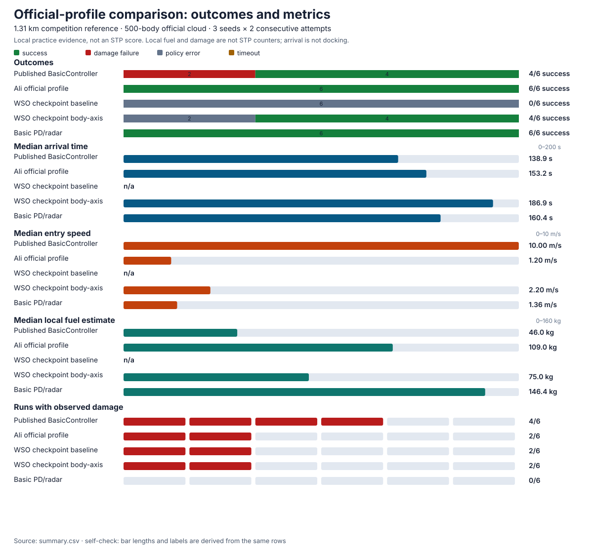

# Western Sydney Orbital

Controller development and flight practice for **Escape from Phobos**, the Fall 2026 Space Teams PRO challenge. The mission is to fly a shuttle from Phobos to the return ship through impact debris, balancing time, fuel and damage.

This repository contains the team's Python controllers, a local practice simulator and recorded flight comparisons. The local simulator is not an exact reproduction of Space Teams PRO. Validate a candidate controller in the licensed competition runtime before submitting it.

## Get started

- Follow the [flight lab setup](docs/flight-lab.md#start-locally), then [fly manually](docs/flight-lab.md#fly-manually) or [run a controller](docs/flight-lab.md#run-a-controller).
- Find each person's entrypoint and shared implementation in [the controller index](controllers/README.md).
- Inspect recorded flights in [Compare flights](https://western-sydney-orbital-api.western-sydney-orbital-worker.workers.dev/compare.html). It needs neither Python nor WebGPU.
- Check the [competition reference and local differences](docs/competition-reference.md) and [scoring notes](docs/scoring.md) before interpreting results.

Use the repository's pinned Nix flake environment and [Just recipes](justfile). Setup, controls, troubleshooting and SDK handoff instructions live in the [flight lab guide](docs/flight-lab.md).

## Repository layout

- `controllers/` — current runnable or shareable STP entrypoints, one folder per person. Shared controller math and adapters live in `src/wsorb/`.
- `src/wsorb/` — shared reviewable Python: flight policy, scoring, transport, controller adapters and the local harness.
- `simulation/` — the Bevy/Rapier practice game, HUD, camera and physics.
- `worker/` — the Cloudflare worker and thin browser platform adapter.
- `docs/` — flight lab, competition notes, minutes, notebook and published analytics.
- `experiments/` — cross-team sweep scripts and comparison configurations.
- `tests/`, `scripts/`, `nix/` — regression tests, operational scripts and pinned toolchain files.

## Competition experiments

For competition-focused practice, select **Competition reference · 1.31 km hop** with **Official debris cloud**. This ports the official relative geometry and 500-body debris distribution into the local model.

The default **Far-side L2** world uses **Transit traffic** moving **Across Phobos** at 20 m/s. It is a separate stress test, not the competition field.

The [official-profile comparison](docs/official-comparison.md) records matched attempts by the published beeline controller, Ali's official-profile policy, WSO's checkpoint profiles and the basic PD/radar reference.

Compare time, arrival speed, fuel and damage together. Local arrival means entry to the station's 50 m region, not docking. Displayed points apply the published formula to local counters; they are not official STP results.

The [older teammate comparison](docs/flight-lab.md#recorded-teammate-flights) used a different broad-stream world. Do not mix its results with the official-cloud or transit experiments. Instructions for [repeating and publishing comparisons](docs/flight-lab.md#repeat-and-publish-a-comparison) are in the guide.

### Team benchmarks

The reviewed benchmarks use different worlds and runner versions. Keep the tables separate; they are not one leaderboard.

**Official STP 0.54.2, 22 seeds, 300 s**

| Person | Controller | Arrivals | Simulation limits | Exceptions |
| --- | --- | ---: | ---: | ---: |
| Ali | `ali_mppi_v2` | 18/22 | 4 | 0 |
| Tom | `tom_polyfit_updated` | 8/22 | 1 | 13 |

Bui and Harry were not part of this campaign. The current v0.56 source has not yet completed a new official campaign. See the [matched campaign evidence](docs/analytics/stp-runs/20261117T040830Z-HY/updated-candidates.md).

**Local official cloud, competition reference, 3 seeds × 2 attempts**

| Person | Controller | Arrivals | Median arrival, s | Median fuel, kg | Runs with damage |
| --- | --- | ---: | ---: | ---: | ---: |
| Ali | official profile | 6/6 | 153.2 | 109.0 | 2/6 |
| Harry | Basic PD + radar | 6/6 | 160.4 | 146.4 | 0/6 |
| WSO | checkpoint body-axis | 4/6 | 186.9 | 75.0 | 2/6 |
| Published | Basic beeline | 4/6 | 138.9 | 46.0 | 4/6 |

Tom and Bui are not in this local official-cloud set. These are local counters, not STP scores. See the [official-profile comparison](docs/official-comparison.md).

**Local far-side L2 broad stream, 5 seeds × 2 attempts, 600 s**

| Person | Controller | Arrivals | Median duration, s | Median fuel, kg |
| --- | --- | ---: | ---: | ---: |
| Tom | Earlier Kalman + velocity governor | 10/10 | 222.7 | 85.0 |
| Bui | Earlier alpha-beta + sidestep | 10/10 | 239.8 | 83.2 |
| Harry | Basic PD + radar (shared baseline) | 10/10 | 224.4 | 304.6 |

Ali is not in this broad-stream set. The Tom and Bui rows use their earlier local adapters, not their current self-contained entrypoints; Tom's current Polyfit is in the STP table. All 30 physical trials arrived with zero measured damage; the results are descriptive matched seeds, not independent draws. See [recorded teammate flights](docs/flight-lab.md#recorded-teammate-flights) and the [summary CSV](docs/analytics/team-comparison/aggregate.csv).

The current Ali MPPI, Tom Polyfit and Bui entrypoints have not yet been run together in one matched benchmark. Do not treat these separate tables as a cross-person ranking.

## Team records

- [Meeting minutes](docs/minutes/)
- [Shared mission notebook](docs/notebook/NOTEBOOK.md)
- [Controller theory and implementation review](docs/python-flight-theory.md)

Historical Lunar SAR experiments and notebooks remain as reference material. Raw sweep outputs stay local under the ignored `runs/` directory; reviewed comparison datasets and charts live in [`docs/analytics/`](docs/analytics/).

Keep connection files, tokens and editor links private. The notebook executes code on its host. Use owner-approved authenticated Tailscale Serve for remote access, not a public editor or Funnel. Cloudflare releases remain owner-controlled.

## Competition resources

- [Escape from Phobos rules and submissions](https://github.com/SimDynamX/SpaceTeamsPRO/discussions/218)
- [Official announcements and discussions](https://github.com/SimDynamX/SpaceTeamsPRO/discussions)
- [Competition simulation source](https://github.com/SimDynamX/STU4-Sim)
- [Controller starter and mission API](https://github.com/SimDynamX/STU4-Solution/wiki)
- [Space Teams PRO documentation](https://github.com/SimDynamX/SpaceTeamsPRO/wiki) and [Python API](https://simdynamx.github.io/stp-python-api-docs/)
