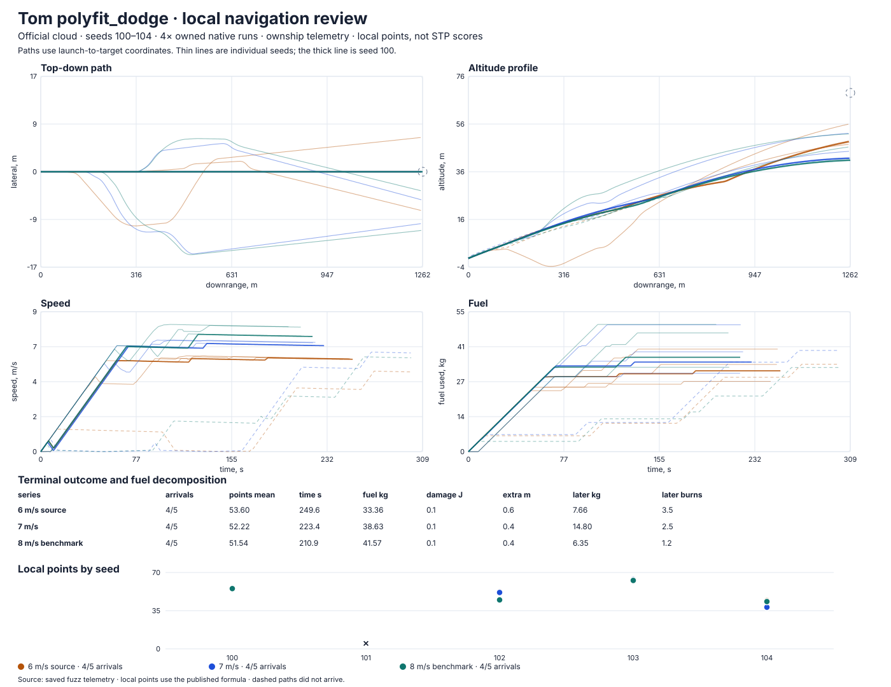

# Tom polyfit_dodge local review

This reviews the current `polyfit_dodge` source at `6c6b305` through a native
port. It is local practice on the official cloud, not an STP run, score or
leaderboard result. The port keeps Tom's policy and only replaces the STP
transport with the native public-observation contract. Tom's source file is
unchanged.



[Open the interactive explorer](explorer.html). It has seed and cruise
selection, 1×/2×/4×/8× playback, top-down and altitude paths, speed, fuel,
control effort, running points, and a direct seed 101 deadlock callout. The page
is self-contained and works offline.

Published evidence: [review.json](review.json), [review.svg](review.svg) and
[explorer.html](explorer.html). The
underlying fuzz reports are in `runs/tom-polyfit-dodge-20261121/` on the machine
that ran them; `runs/` is not versioned. The review port is
`src/wsorb/controllers/_tom_polyfit_dodge.py`; the profile is
`tom_polyfit_dodge`.

## Test setup

- Official competition reference, official cloud, seeds 100 to 104.
- Five fresh runs per cruise setting, 300 s simulation budget, 4x owned native
  playback, 40 Hz wall-clock decisions.
- Tom's source cruise is 6 m/s. I also ran 7 and 8 m/s with the same policy to
  measure the fuel and time trade-off.
- Local points use the published formula on local time, fuel and damage. They
  are not STP points.

## Results

| Cruise | Arrivals | Mean points | Mean time | Mean fuel | Fuel after launch burn |
| ---: | ---: | ---: | ---: | ---: | ---: |
| 6 m/s (source) | 4/5 | 53.60 | 249.6 s | 33.36 kg | 7.66 kg |
| 7 m/s | 4/5 | 52.22 | 223.4 s | 38.63 kg | 14.80 kg |
| 8 m/s | 4/5 | 51.54 | 210.9 s | 41.57 kg | 6.35 kg |

| Seed | 6 m/s points | 7 m/s points | 8 m/s points | 6 m/s fuel | 7 m/s fuel | 8 m/s fuel |
| ---: | ---: | ---: | ---: | ---: | ---: | ---: |
| 100 | 55.27 | 55.43 | 55.25 | 31.64 kg | 35.06 kg | 36.94 kg |
| 101 | timeout | timeout | timeout | 34.21 kg | 39.63 kg | 32.95 kg |
| 102 | 52.43 | 51.69 | 44.86 | 34.14 kg | 39.11 kg | 46.50 kg |
| 103 | 62.35 | 63.62 | 62.69 | 27.51 kg | 30.69 kg | 33.04 kg |
| 104 | 44.35 | 38.12 | 43.34 | 40.15 kg | 49.66 kg | 49.80 kg |

Six metres per second wins. Seven loses 1.38 mean points and eight loses 2.06.
Six to seven spends 5.3 kg to save 26.2 s: about 7.0 points of fuel for 5.6
points of time. Six to eight spends 8.2 kg to save 38.8 s: 10.9 points of fuel
for 8.8 points of time.

Seed 103 needs 27.5 kg and scores 62.35. Seed 104 flies the same route, needs
40.2 kg and scores 44.35. That 18-point spread is almost all avoidance fuel.
The 7 m/s seed 104 is worse still: 49.7 kg and 38.12 points.

## How it navigates

The nominal path is a direct 1.31 km beeline. On arrived runs the path length is
within 2 m of the straight line. Dodges are short lateral or vertical sidesteps.
The controller does not plan around the cloud or choose a lower-density corridor.
It flies at the target and reacts when a rock enters the 50 s clearance window.

That is a reasonable choice for this cloud. The lateral excursions are mostly
2-10 m, and the small candidate is cheap. The problem is not the beeline. It is
the decision logic around the beeline.

## 1. Avoidance deadlock

This is the most important finding. Seed 101 fails at all three speeds, and at
8 m/s it sits at zero speed for about 80 s.

6 m/s seed 101:

- Accelerates to 1.4 m/s by 20 s.
- Holds 1.4 m/s with zero command from 20 s to 95 s.
- Brakes from 1.24 m/s to zero between 98 s and 108 s.
- Holds zero until 169 s.
- Re-accelerates to 5 m/s and ends 697 m short at the 300 s budget.

`Avoider.choose` minimizes `|candidate - current_velocity|` and includes
`wanted_velocity * 0.0`, `0.25` and `0.5` in the candidate set. When a hazard
blocks the direct path, a slow or zero candidate can be the cheapest safe
change from the current velocity. Once the shuttle is stopped, zero velocity is
safe and closest to the current velocity, so the next decision chooses it again.
The controller waits for the rock to clear instead of resuming the route.

The source writes `self.last_dodge` but never reads it. The older `polyfit`
version kept the previous dodge while it was safe. That hysteresis is gone.

Suggested fix:

- Require an along-track speed floor for every non-emergency candidate, for
  example 0.6 to 0.7 of cruise.
- Score candidates by change from current velocity plus a progress penalty:
  `dv + lambda * max(0, cruise - along_speed)`.
- Keep the previous dodge if it is still safe. Add a switching cost so the
  choice does not flip between two similar candidates.
- Allow a full stop only when time to collision is inside the emergency window.

This one change recovers seed 101 and removes most of the run-to-run variance.

## 2. Radar timing regression

`polyfit_bodge` added own-state history and interpolated the shuttle position at
each radar timestamp before rebasing the row. `polyfit_dodge` dropped that code.
It adds the current shuttle position to every row, including rows measured
seconds earlier.

The local official cloud rolls one actor per 120 Hz iteration and publishes
every 50 rows. One full revisit takes 500 / 120 = 4.17 s. A row that old is
misplaced by 25 m at 6 m/s and 33 m at 8 m/s. The avoidance margin is 6 m. The
simulator sorts the published rows by distance and the policy takes the nearest
150, so a single scan mixes rows from across that 4.17 s window.

The velocity fit is affected too. If the row age changes across sightings, the
polyfit slope can pick up as much as the shuttle's own speed as apparent rock
velocity.
A rock can look like it is moving with the shuttle, which keeps the predicted
collision alive and makes the deadlock worse.

The fix already exists in `controllers/tom/polyfit_bodge/Controller.py`:
`RadarTiming.prepare` stores 10 s of own-state history, interpolates the pose at
each row timestamp, rejects future, stale, repeated and unbracketed rows, and
rebases before tracking. Copy that class and its call in `Tracker.update`.

Check the licensed runtime's `Radar/NumDebris` and schedule before claiming the
same 4.17 s cycle. Even a 1 to 2 s cycle gives a 6 to 16 m error at these speeds,
which is the same order as the safety margin.

## 3. Use the radar range and range rate

Each row already contains surface distance in `item[1, 0]` and range rate in
`item[1, 1]`. The policy ignores both and waits for three position samples before
it has a velocity. With a 4.17 s revisit, three samples take more than 8 s.

Add a raw-row guard:

- `range = item[1, 0]`
- `closing = -item[1, 1]`
- If `closing > 0` and `range / closing` is inside the reaction window, command
  a lateral burn even if the tracker has no velocity yet.
- Compare the fitted radial velocity with the measured range rate. Reject or
  reinitialise a track when they disagree.

This gives collision detection on the first sighting and catches association
errors that the polyfit tracker cannot see.

## 4. Track lifetime and cone

`Tracker.max_age` is 5 s. A 4.17 s revisit leaves only 0.83 s of margin. One
missed publication drops the track and its velocity estimate. Raise the track
age to 10 to 12 s.

The 90 degree cone is applied before tracking. A rock that leaves the cone is
forgotten after 5 s. Track every row and apply the cone only when choosing
avoidance candidates. This costs memory, not fuel, and keeps velocity estimates
alive through a dodge.

`find_match` uses a greedy 15 m gate and a 25 percent diameter tolerance. In a
dense field two nearby rocks can swap identities. Use a global assignment or a
constant-velocity gate, and reject matches whose range rate disagrees with the
track.

`update_velocity` is an unweighted least-squares fit over up to 30 samples. One
bad association bends the velocity. A robust fit, or a small alpha-beta filter,
is enough here.

## 5. Candidate safety and reaction time

The nominal path is accepted when clearance is greater than zero. Candidates
need clearance greater than the 5 m buffer. Use one threshold for both.

`clearance` assumes the new velocity applies immediately. The calibrated plant
delivers about 0.11 m/s squared. A 0.3 m/s change takes about 2.7 s. A 4.5 m/s
change takes about 41 s. During that ramp the shuttle keeps moving. Add a
reaction inflation to the keep-out:

```text
keep_out += shuttle_speed * radar_age + 0.5 * delivered_accel * response_time^2
```

The 6 m margin alone does not cover a late, large dodge.

The candidate set includes `along = -0.3`, a 1.8 m/s slowdown at 6 m/s. It is
rarely the cheapest safe option, but when it is chosen it costs fuel and time.
Prefer lateral candidates and add smaller along-track fractions only when time
to collision is short.

Twelve angles at 30 degree spacing is coarse. Refine around the best candidate,
or use 16 to 24 angles only when time to collision is inside a few seconds.

## 6. Speed gate and fuel counter

`GoalPlanner.miss_distance` has two accidental couplings:

```python
if (speed < 0.95 * cruise_speed)
and (norm(target_position) - norm(shuttle_position) > 1100.0)
and fuelUsed < 35.0:
    return inf
```

`norm(target) - norm(shuttle)` is not the shuttle-target distance. It happens to
be about 1305 m at the local launch because both positions sit far from the
origin. In another frame it can be negative, and the acceleration gate stops
working.

`fuelUsed < 35` makes the effective cruise depend on fuel. At 8 m/s the run
crosses 35 kg before reaching 8 m/s, then settles between 7.2 and 7.8 m/s
depending on the path. That is why the "8 m/s" rows are not consistent.

Use the real distance and a speed-only gate, for example
`speed < 0.98 * cruise_speed`. Keep fuel decisions in one place.

The 0.95 factor also means a 6 m/s setting settles at 5.7 m/s. If the intent is
6 m/s, set 6.3 or change the threshold.

## 7. Logging cost

The loop calls `OnScreenLogMessage` for distance, time to collision and velocity,
plus a dodge line. At 10 to 40 Hz that is 30 to 120 calls per second. It is not
the main fuel cost, but it adds jitter to a command lease measured in
simulation seconds. Throttle these to 1 Hz or log only state changes.

## What is already working

- Terminal coast. The policy does not brake at the 50 m region, which is correct
  for the score. Braking from 6 m/s would cost about 26 kg, roughly 35 points,
  and there is no arrival-speed gate.
- Small dodges. Most arrived runs use two to four short burns and stay within a
  few metres of the beeline. The smallest sideways candidate is usually chosen.
- Almost no measured damage. The largest reading was 0.29 J, far below the
  209,200 J limit. The local cloud is sparse and the margins are enough on the
  seeds that arrive.

## Navigation strategies that fit this controller

The avoider is a velocity sampler. That is a known family, and several published
methods map onto small changes to your existing loop.

Dynamic window approach. DWA samples the velocities reachable in the next
control interval and scores each one on obstacle distance, heading and speed.
Your candidate sampler already does the reachable-velocity part. The missing
piece is the heading term. Add a progress score to the candidate cost and the
stop-trap disappears. [Fox, Burgard and Thrun, 1997](https://doi.org/10.1109/100.580977)

Velocity obstacles. A moving rock maps to a cone of forbidden velocities. If the
goal velocity is inside a cone, project it to the nearest point outside the
union of cones. That replaces the 216-candidate search with a geometric
calculation. Keep the sampler as a fallback when many cones overlap.
[Fiorini and Shiller, 1998](https://journals.sagepub.com/doi/10.1177/027836499801700706)

Control barrier safety filter. Your clearance is a one-step check at the new
velocity. A discrete-time barrier checks the next state and keeps a positive
margin: `h(next) >= (1 - gamma) h(now)`. This is a cheap projection after the
candidate is chosen, and it catches the transient that the current clearance
ignores. [Ames et al., 2019](https://arxiv.org/abs/1903.11199)

Zero-effort miss. Spacecraft guidance uses the miss distance if neither vehicle
manoeuvres, plus time-to-go. You already compute closest approach. Adding the
radar range rate gives the same quantity on the first sighting, before three
polyfit samples exist. [Palumbo et al., 2010](https://secwww.jhuapl.edu/techdigest/content/techdigest/pdf/V29-N01/29-01-Palumbo_Homing.pdf)

Tangent-bug escape. When no candidate makes progress, follow the tangent around
the keep-out sphere instead of stopping. This is a local-minimum escape from the
range-sensor navigation literature, and it fits as the fallback branch of your
sampler. [Kamon and Rivlin, 1998](https://journals.sagepub.com/doi/10.1177/027836499801700903)

Inevitable collision states. A state is inevitable if no future trajectory can
avoid collision. Use the delivered acceleration limit to estimate the lateral
displacement available before time-to-collision. If it is less than the required
miss, reject the candidate now instead of waiting for the rock to get closer.
[Fraichard and Asama, 2004](https://inria.hal.science/inria-00182082)

Glideslope. A terminal approach along a fixed line with a decreasing speed
profile is standard for rendezvous. You do not need it for score, because there
is no arrival-speed gate. Consider it only if damage at the station region
starts to appear.

Global graph search. A* or RRT* would add latency and a map-maintenance problem
for a 1.3 km hop through a local cloud. The direct beeline plus a better local
avoider is the lower-risk path. Keep the global layer out unless the cloud is
dense enough that local dodges cannot make progress.

## Suggested order

1. Fix the avoidance deadlock. Add a progress floor and keep stop as an
   emergency option.
2. Restore `RadarTiming` from `polyfit_bodge`.
3. Add the raw range and range-rate guard.
4. Raise track age to 10 to 12 s and track outside the cone.
5. Use one clearance threshold and add reaction-time inflation.
6. Re-run 6, 7 and 8 m/s with those fixes. In this test the optimum is 6 m/s,
   with 7 close and 8 clearly worse.
7. Keep terminal coast unless damage starts to appear.

## Reproduce

From the repository root inside the Nix environment:

```sh
nix develop
uv run --locked wsorb fuzz --world official --profile tom_polyfit_dodge \
  --seeds 100-104 --duration 300 --playback-rate 4 \
  --settings '{"cruise_speed_mps": 6.0}' \
  --out runs/tom-polyfit-dodge-20261121/official-cruise6-seeds100-104.json
```

Repeat with `7.0` and `8.0`, then render:

```sh
uv run --locked python experiments/tom_polyfit_dodge_review.py \
  --series "6 m/s source=runs/tom-polyfit-dodge-20261121/official-cruise6-seeds100-104.json" \
  --series "7 m/s=runs/tom-polyfit-dodge-20261121/official-cruise7-seeds100-104.json" \
  --series "8 m/s benchmark=runs/tom-polyfit-dodge-20261121/official-cruise8-seeds100-104.json" \
  --output docs/analytics/tom-polyfit-dodge/review.svg \
  --json docs/analytics/tom-polyfit-dodge/review.json
```

Build the explorer:

```sh
uv run --locked python experiments/tom_polyfit_dodge_explorer.py \
  --series "6 m/s source=runs/tom-polyfit-dodge-20261121/official-cruise6-seeds100-104.json" \
  --series "7 m/s=runs/tom-polyfit-dodge-20261121/official-cruise7-seeds100-104.json" \
  --series "8 m/s benchmark=runs/tom-polyfit-dodge-20261121/official-cruise8-seeds100-104.json" \
  --output docs/analytics/tom-polyfit-dodge/explorer.html
```

## Limits

The local engine is not the licensed STP runtime. The 4x playback changes
decision timing, and the local damage and fuel counters are approximations. The
review port is a faithful copy of the policy, not a claim that the STP transport,
radar schedule or physics match. Local points are the published formula applied
to local counters.
