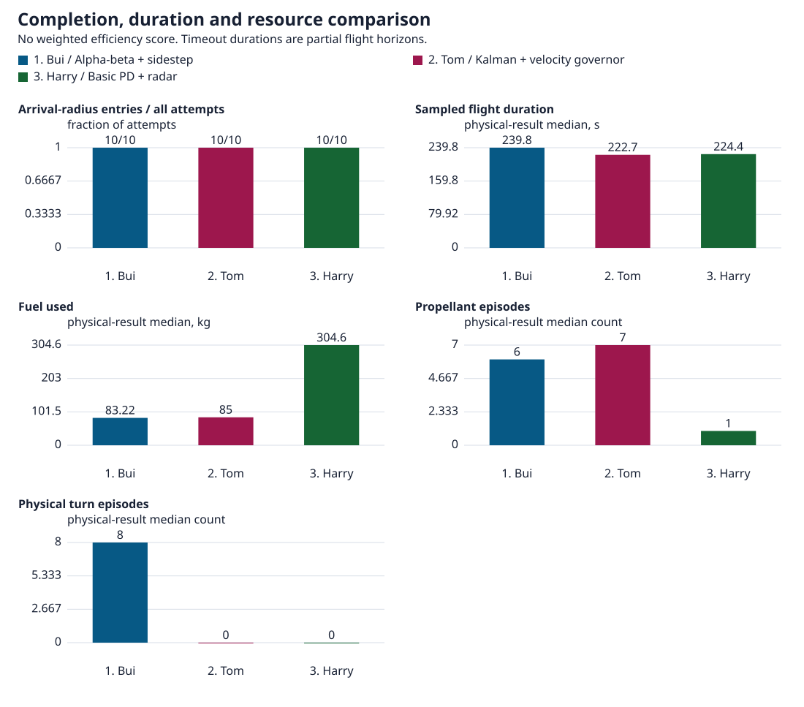

# Flight lab guide

The [README](../README.md) introduces the competition and the team's work. This guide covers setup, flying, controller experiments and the limits of the local model.

- [Start locally](#start-locally)
- [Fly manually](#fly-manually)
- [Run a controller](#run-a-controller)
- [Other ways to start](#other-ways-to-start)
- [Inputs and launch placement](#inputs-and-launch-placement)
- [Debris settings and model limits](#debris-settings-and-model-limits)
- [Notebook policies and failures](#notebook-policies-and-failures)
- [Hosted Python connection](#hosted-python-connection)
- [Diagnostics](#diagnostics)
- [Reading the comparison](#reading-the-comparison)
- [Licensed SDK handoff](#send-a-controller-to-a-colleague)

## Start locally

Install Nix, devenv and Just. Enter the pinned environment from the repository root, then run project commands inside it:

```sh
devenv shell
just setup
just build
devenv up lab simulation
```

The first build can take several minutes. Later builds reuse unchanged outputs.

1. Open **http://127.0.0.1:61829/** in a current browser with WebGPU enabled.
2. Wait for the world to appear. Keep one game tab visible and press **F** to follow the lander.
3. Select **Notebook** in the bottom toolbar to open the private Python editor. It normally uses port `2718`; open it through the game rather than sharing its access link.

Leave the processes running while you work. `devenv processes down` stops them. Use `devenv up -d lab simulation` for background operation.

For game-only sessions, Windows, headless physics or startup logs, see [other ways to start](#other-ways-to-start). Do not start a second server accidentally.

## Fly manually

The world starts paused. Click the scene, then select **Play** or press **P**. Pausing freezes the lander and debris together.

| Key | Action |
| --- | --- |
| P | Play or pause. |
| Space | A fresh press launches from pause; hold for upward thrust. |
| E / Q | Thrust up / down. |
| W / S | Fire front / back nozzle, pushing backward / forward. |
| A / D | Fire left / right nozzle, pushing right / left. |
| F / Shift+F | Follow the lander / frame the selected object. |
| 5 / 6 / 7 | Overview / top ship camera / bottom ship camera. |
| H | Full controls and key bindings. |

Nozzles belong to the lander, not the screen. Releasing a key stops thrust, not velocity or spin. Use opposite thrust to slow down. Drag, wheel or pinch to adjust the view; hold Alt/Option with movement keys to move only the viewing camera.

Use **Flight** for measurements, **Ship** for live hardware inputs, **Debris** for the debris field and **Launch** for placement or a new world. **Views** changes the camera and lighting.

Increasing thrust strength does not fire an engine. Check the clock and last-applied thrust reading when an edit seems to do nothing. The [input and placement guide](#inputs-and-launch-placement) explains live changes, new-world drafts and moving the launchpad.

## Run a controller

### From the notebook

1. Open **Flight → Connect / Refresh**. This reads the existing flight and draws guidance; it does not fly the lander.
2. Open **Python policy** to choose a controller and inspect its settings or code.
3. Select **Run controller** to hand over control. Its first valid command can resume an eligible paused flight.
4. Watch the native mission status, target range, relative speed, damage and fuel in **Flight** and **History**. A drawn route is not an arrival.
5. Select **Stop Python control** to end the worker and standby. In resilient mode, Stop releases control without pausing physics. Use **P** or **Pause physics** to pause as well. Older baseline controllers also pause during cleanup.

Keep one controller in charge. Manual thrust, pause, placement or reset can end Python control. Pressing Play again does not restart the controller. Release held movement keys after a handover if the game asks.

### Choose a teammate profile

The source entrypoint for each person is indexed in [examples/README.md](../examples/README.md).

Python runs on a teammate's machine, never on the hosted site. Hosting stays on Cloudflare Free. Use the local game or the [private room relay](#hosted-python-connection) to connect that Python runner to a browser flight.

Choose a profile in the footer below the scene, then use **Run flight**. **More options** or **Shift+C** opens the full panel for teammate, world, seed, time budget and connection setup. **Run flight** stays disabled until the game is ready and the connected Python service confirms it is online and idle. Run queues the selected code on your machine and opens the lander view. **Cancel startup** stops flight preparation before submission; if submission is already confirmed, it requests Stop for that exact job. It does not shut down the Python service.

The launcher offers the competition hop with the official debris cloud, the historical L2 settings from the saved teammate comparison, and the current Across Phobos practice world. Seeds are whole numbers from 0 to 4294967295. A comparison row's **Fly this code** link fills these choices without starting a flight or Python. It still requires a runner on your machine. New runs use the current local engine and live Python timing, so they can differ from saved runs.

For a locally served game, run this from the repository root inside `devenv shell`, after `just setup` and `just build`:

```sh
WSORB_LAB=1 just local
```

In a second terminal, enter `devenv shell` in the same checkout and start the private runner:

```sh
uv run --locked wsorb controllers serve --connection-file .devenv/wsorb-local.json --run
```

**Run flight** starts directly in a fresh tab and asks before replacing a flight that has already started. Keep the tab visible while Python flies. Live time, range, speed, fuel and damage stay below the scene beside **Stop controller**. Changing a profile or world requests Stop first. It does not start the next profile automatically.

If `devenv up lab simulation` already serves your local game, leave it running and only start the runner in the second terminal. Do not start another game server.

Check **Controller running**, not just **API connected**. The game must have accepted the controller's command and be running physics. The status panel shows the command time and expiry.

Native command limits remain **0.5 m/s²** and **0.05 rad/s²**. Local `success` means entry to the station's 50 m region, not docking or a safe arrival speed. See [debris settings and model limits](#debris-settings-and-model-limits) before interpreting a practice result.

For run budgets, sensor failures, standby takeover and isolated CLI runs, see [notebook policies and failures](#notebook-policies-and-failures).

## Other ways to start

Run commands from the repository root inside `devenv shell`. The normal game-and-notebook setup is in [Start locally](#start-locally).

For a game-only session after `just setup` and `just build`, use `PORT=0 just local` and open the exact address printed in the terminal. `just local` serves the existing build. Choose this or the managed game-and-lab setup, rather than starting both.

For background processes, use `devenv up -d lab simulation`. `devenv processes logs lab` shows the editor's startup message. The process named `notebook` is a separate sharing service, not the Marimo flight lab.

### Without a browser

```sh
WSORB_LAB=1 WSORB_HEADLESS=1 just local
```

This starts a separate native-headless flight through the private loopback API. It runs the built engine's physics, sensors, playback and telemetry schedules. No renderer starts and camera capture reports no sample. The notebook connects through the private connection file, and **Pause physics** works without a game window. This mode does not attach to or reset a browser flight.

### Windows game engine

The game is WebAssembly with WebGPU, not a native Windows executable. For a prebuilt game, use a supported Windows 11 machine, Node 26.12.1 or later in the 26.x series, and current Chrome or Edge with working hardware-accelerated WebGPU. Copy the complete matching `worker/public` assets from `just build`; a source checkout alone does not contain the generated engine.

From PowerShell at the repository root:

```powershell
node .\worker\scripts\platform-probe.mjs
if ($LASTEXITCODE -ne 0) { throw "CPU/WASM probe failed" }
$env:WSORB_LAB = "0"
$env:WSORB_HEADLESS = "0"
$env:PORT = "0"
node .\worker\scripts\local.mjs
```

Open the exact loopback URL printed by the server. The probe verifies actual WASM integrity and physics on the machine running it; it does not certify WebGPU, rendered frames or camera RGB readback. Those checks still need to run on the Windows GPU and driver. No Windows runtime or GPU pass is claimed from macOS tests.

For building or using the private Python lab and control APIs, run the backend inside WSL2 with the repository and secrets on its Linux filesystem under the WSL home. Do not assume `/mnt/c` or Windows `chmod` provides the POSIX private-file protection these services require. Verify Windows-to-WSL localhost forwarding for both game and notebook ports. Native Windows private-lab ACL support is not implemented; the game-only command above does not enable private control.

## Inputs and launch placement

The initial Overview shows Phobos and Mars at their actual modelled sizes and separation. Press **F** for a close view of the lander. Use **Views** to change the camera, lighting, stars or guide visibility.

The two practice launch setups let us compare departures on opposite sides of Phobos:

```text
Mars -------- L1 -------- Phobos -------- L2
```

This diagram is not to scale. **Mars-facing L1** launches toward the region between Phobos and Mars. **Far-side L2** launches away from Mars toward the outer region. L2 is not on the Mars-facing side. The return ship is held near the selected region as a repeatable target. The **Competition reference · 1.31 km hop** preset uses the official 1305.8 m shuttle-to-target geometry and 50 m keep-out. It is a local port, not an STP-certified mission.

Both setups include Mars's gravity. From the close far-side launch view, Phobos can block Mars from sight; that does not remove its gravitational effect.

Press **H** for full controls. **Tab** moves keyboard focus, **Enter** activates a control, and **Esc** cancels editing or closes a panel.

### Edit inputs and inspect the result

Open **Ship** or **Debris** to edit live inputs. Editable controls change the underlying physical settings. Measured speed, force, spin, fuel use and damage are readouts, not numbers we overwrite to make a run look successful.

| Change | What to expect |
| --- | --- |
| Lander mass | Updates the existing body without moving it or resetting the clock. |
| Inertia factor | Changes how hard it is to start or stop the lander spinning. The actual inertia readings are shown separately. |
| Local thrust strength | Changes the force available from an existing command. It does not start a command or resume a paused flight. |
| Stream speed and direction | Changes the common flow of existing stream debris. Individual collision and gravity effects are retained. |
| Stream speed spread | Changes newly spawned rocks, not a fresh random velocity for every existing rock. |
| Count, sizes, coverage, launch setup or debris mode | Prepares a new-world configuration. Apply it explicitly to replace the current trial. |

Select a numeric editor, enter a value and confirm it with **Enter** or **Apply**. Leaving the field also commits it; **Esc** cancels typing. The **+** and **-** buttons make small adjustments. Read any validation message beside the controls, and check the confirmed physical reading rather than assuming the requested value was accepted.

The flight strip keeps speed, clearance, climb, target distance, closing speed and last-applied thrust visible. Clearance is measured from the lander's centre; it is not the gap beneath its feet. Instrument timestamps distinguish a current request from the last force actually applied. While paused, changing a force does not advance motion.

### Move the launchpad on Phobos

Open **Launch** and select **Place lander**. This pauses flight and frames the current launch site. Drag the launchpad or its handle along Phobos, then release to move the pad and seat the lander upright at rest. There is no second Apply step after a drag. The preview follows the actual terrain; it does not change physics until you release. **Esc** cancels, and flight stays paused.

To place without dragging, select **Place lander**, then click a surface point or use the directional buttons or arrow keys to adjust the preview. Select **Apply** to use that site. You do not need to enter XYZ coordinates.

Moving the launchpad keeps the debris field, simulation time, hardware, fuel, damage and mission outcome. It clears the lander's thrust and motion and records a local test intervention. The selected L1, L2 or competition-reference target does not move with the pad. A blocked or cancelled placement leaves the existing site unchanged.

Reset flight returns to the chosen custom launch site. Creating a new world returns to that preset's starting site.

### Choose a target setup or place the lander separately

In **Launch**, expand the new-world setup to choose **Competition reference · 1.31 km hop**, **Far-side L2** or **Mars-facing L1**. Choose **Official debris cloud** or a practice debris mode in **Debris**. **Create paused world** opens a replacement confirmation; **Replace run at time zero** applies it. Expand **Size, shell and ejection inputs** for advanced settings. The default is far-side L2 with 500 debris bodies moving **Across Phobos** in the negative world-Y direction at a mean 20 m/s, with a 4 m/s birth-speed spread and light attraction off. Choosing a draft does not replace an ongoing flight or limit where you can drag the current pad.

The advanced lander-only placement controls are a different tool. Enter world X, Y and Z coordinates and select **Apply XYZ position** to move the lander without moving its pad. **Reload current XYZ** fills the fields from the current lander position. Placement pauses flight, aligns the lander away from Phobos, stops its motion and clears thrust. Placement inside another body or outside the supported world is rejected.

The notebook's **Launch → Separate lander placement, advanced → Place lander only** controls move only the lander. A rejected placement leaves the Python controller attached; a valid placement stops its worker.

Placement is recorded as a test intervention, not a flown manoeuvre. It does not erase fuel, damage or a completed mission result. Use **Reset flight** before trying to fly another completed mission. Zero coordinates are the centre of Phobos, not a safe launch location.

Positive X points toward Mars; negative X points away. These are world coordinates, not directions relative to the camera or lander.

## Debris settings and model limits

Debris bodies have mass, velocity and spin. Gravity changes their paths, and physical collisions can change their motion. They do not move merely because the renderer advances a decorative animation.

- **Official debris cloud** is the 500-body competition distribution: a compact cloud offset 500 m toward the target, 0.40–0.80 m/s drift, weighted rock classes and radii up to 20 m. Its fixed count, sizes and extents are not edited by the practice sliders.
- **Transit traffic** is a custom 20 m/s stress mode, not the competition field. Its default **Across Phobos** flow crosses the launch-to-station route rather than heading toward Phobos or along the route. It has 500 physical bodies. Mean speed, axis, sign and birth spread remain editable in **Debris**.
- **Broad shell stream** preserves the earlier surrounding-Phobos stream. New rocks enter through the upstream side as others leave its bounded area.
- **Impact ejecta** starts a debris cloud with an adjustable velocity kick and direction. Gravity and collisions then determine its paths. Some rocks can remain bound, some fall back and some escape. A circular belt is not guaranteed.

The ejecta setup represents debris after an impact. It does not model a rock breaking into fragments. Stream calibration controls and ejecta starting conditions are different experiments; use the controls for the active mode.

To try light attraction, use **Launch → New world → Light lander attraction → Light attraction**, then confirm **Create paused world**. It is off by default and selecting it does not change an existing flight. Small physical impulses turn debris toward the lander; they do not lock velocities or teleport rocks. Adjustment stops inside 100 m. Archived broad-stream and impact worlds keep their original settings.

The [published debris script](https://github.com/SimDynamX/STU4-Sim/blob/c1e3fc8f9ee3b189bba64d8bd87818a8003639cc/Systems/SpawnDebris.py) contains this routine with `doTrajectoryAdjustment = False`. Its optional update is a 0.02 m/s impulse to one body per overall 60 Hz iteration, not to every body at 60 Hz. Our scheduler uses simulation time for repeatable local trials. The route traffic volume and coherent mean direction are requested practice settings, not a claim about the official random-tangent initialization or asynchronous timing.

The 20 m/s transit stress field is not arrival-validated. In the earlier flow configuration, with attraction off and seed 100, default A* guidance failed on impact at 54.75 s and Bui's adapter at 44 s. Those recorded failures do not measure the new Across Phobos default or establish the official-cloud result. Verified Start/Stop behaviour and older broad-stream arrivals do not establish safe navigation through either field.

Gravity remains active for the lander and every asteroid. The local model includes Phobos gravity, differential Mars gravity and the rotating-frame Coriolis and centrifugal terms. It is a circular point-mass approximation, not STP's SPICE ephemeris runtime. Mean-flow inputs do not overwrite the gravitational or collision response every frame.

Start with the default 500 bodies. Larger trials can request 10,000 or 100,000 real bodies, but the upper input limit is not a promise of smooth play on every machine. Dense fields or narrow spawn regions may not fit the selected sizes. Read setup errors and watch the simulation clock. A heavy world can take longer than an actual second to simulate one second. Use short paused steps for large trials.

## Checkpoint attempts

Inspect a fresh isolated world without issuing flight commands:

```sh
devenv shell uv run --locked wsorb checkpoint --isolated
```

Explicitly run matched baseline and body-axis attempts in separate stock worlds:

```sh
devenv shell uv run --locked wsorb checkpoint --isolated --run --policy compare --playback-rate 5 --cadence-hz 50
```

This script uses authenticated HTTP calls and the same portable numeric controller as the colleague-facing STP script. It does not click the interface, reset an open flight, call a fixed-step test driver or emulate `spaceteams`. The two portable profiles differ only in body-axis preference; they are separate from the notebook's native-contract resilient A* controller. Default inspection is read-only, and default playback is 1×. Accelerated runs can expire their leases when computation or transport is too slow; expiry is a failed attempt, not permission to extend or retime the decision.

The final JSON reports native arrival, range, speed, damage, fuel and source/configuration diagnostics. Native score availability depends on the preset. `competition_reference` uses the current published formula on local counters; L1/L2 practice modes remain natively unscored. Neither is an official STP receipt. A run succeeds only on native mission success with the unchanged arrival/damage limits. L1 command effort is a proxy, not fuel. No report files are written automatically. To inspect an existing local flight, supply an explicit `--connection-file`; it is never implicitly reset, tuned or used for comparison.

## Hosted Python connection

Python runs privately on your machine. The existing Cloudflare Free room relay sends authenticated calls to the real WASM engine in your browser; it does not host Python or publish the controller's source. To watch a hosted flight, keep both your local runner and the browser running.

From the repository root inside `devenv shell`, create a private room:

```sh
uv run --locked wsorb room create --connection-file .devenv/wsorb-room.json
```

Open the private browser link printed by this command in a new tab, then choose **Allow Python connection**. This starts a separate game; leave existing flights open. Keep the new game visible in a separate window. Start the profile runner on your machine:

```sh
uv run --locked wsorb controllers serve --room-file .devenv/wsorb-room.json --run
```

Then choose the code profile in the footer and use **Run flight**. **Check connection** and the world, seed and time budget are under **More options**. **Run flight** becomes available only after the game is ready and Python is online and idle. Room creation and connection alone do not start a controller.

If **Fly this code** already opened a game with your choices selected, append the private link's `#room=…&key=…` fragment to that tab's existing address instead of opening another game. Keep its query parameters intact and allow Python. The loaded game accepts this fragment without resetting physics or losing the selected profile, world, seed or time budget.

For the separate portable checkpoint CLI, inspect first, then explicitly start its policy instead of running the profile service against the same flight:

```sh
uv run --locked wsorb checkpoint --room-file .devenv/wsorb-room.json
uv run --locked wsorb checkpoint --room-file .devenv/wsorb-room.json --run --progress
```

Keep the link and connection file private. A room cannot replace an already connected owner. Room calls read fresh public observations, not saved room state or hidden debris truth. Flight control uses the native ownership fence and original-source expiring commands. A disconnect never retries thrust, resets the game or extends a decision's validity. Manual ship input or pausing ends the run. The hosted bridge deliberately excludes reset, tuning, raw latched thrust and private local-lab endpoints. Network latency may exhaust a lease and end an attempt; this connection is not STP runtime validation.

Add `--wait-for-owner-s 3600 --progress` when Python should wait for the external game to connect. Waiting is read-only, stays within the invocation's total wall budget, and does not grant `--run` consent. Browser readiness requires advancing real renderer counters; native-headless readiness uses its actual scheduler status. An existing controller is not replaced. Only read-only owner/network unavailability is retried, with bounded wait-error logs; authentication and protocol failures end the wait. Flight commands are never retried. Read-only hosted observations remain available when the initialized page is hidden, but commands still require a visible game.

For a demo that must remain available until you return, use `--await-owner` instead of a finite owner wait. This explicit external-connection mode waits read-only without a startup expiry. The configured flight budget begins only after actual readiness, then Python runs or inspects once and exits. It does not repeat failed flight commands, restart a completed run or grant `--run` consent by itself.

New local backends return the actual browser page ID with snapshot receipts. The checkpoint client pins that verified ID before claiming control; a changed or missing target is rejected before dispatch, and the client never silently rebinds. Legacy or native-headless backends without a browser receipt remain explicitly unpinned.

An instrumented, already-loaded hosted game also accepts a private room link through a fragment change without restarting its WASM or physics. It still asks for permission, and refuses to replace an active or pending room connection. The local game shows which tab owns its Python API connection; separate tabs and hosted rooms are separate flights, not mirrored views. A new game URL can opt into a close lander view with `?follow=lander`; this requests only a debug-camera change after real renderer readiness.

A local game started with a separate connection file does not redirect its Notebook button to the default flight's editor. Its help page identifies the explicit API connection instead, so opening the notebook cannot silently control a different game.

## Diagnostics

Diagnostics are off by default. Collect a short, read-only log from an existing flight without starting a controller or changing its playback:

```sh
devenv shell uv run --locked wsorb diagnostics --connection-file .devenv/wsorb-local.json --duration-s 5 --output .devenv/flight-debug.jsonl
```

Use `--room-file` for a hosted flight. The output path must be unused; logs are private mode-0600 JSONL. The collector skips a busy local API rather than competing with the controller. It records actual source clocks, ownership, Rapier motion and renderer counters. Page identity, debug camera and Bevy visual transforms are included only when the loaded bridge/engine supplies them; older builds report them unavailable.

Add `--diagnostics` to an explicit checkpoint invocation for correlated transport logs on stderr, or set `WSORB_DIAGNOSTICS=1` before starting Python or the local backend. Unset the flag to return to the default. Python calls `wsorb.diagnostics.enable()` and `disable()` affect the current Python context; the environment flag also covers worker threads.

An instrumented browser exposes `globalThis.__wsorbDiagnostics.enable(true)` and `enable(false)`. A new game can also opt in with `?diagnostics=1`. Do not navigate or reload an active flight just to enable logs. Browser events are bounded, and disabling clears native collection; per-request native collection otherwise expires after two seconds. Visual-transform samples are main-world Bevy measurements, not proof of GPU pixels.

All logging passes through dedicated helpers. Tokens, capability URLs, raw error text, camera pixels, radar rows and hidden debris state are excluded. No collector command resets, reloads, claims control or retries actuation.

With the local server's `WSORB_DIAGNOSTICS=1` flag, allowlisted startup asset deliveries are logged before a browser claims the API. Fixed asset labels and HTTP statuses distinguish a page that never requested the game from an asset-load failure; they do not claim renderer readiness.

For loading problems, copy startup diagnostics from the game's error screen. `node worker/scripts/platform-probe.mjs` checks the built WASM and physics on this machine; it does not test browser graphics.

## Notebook policies and failures

The [controller steps](#run-a-controller) cover connecting, running and stopping. Connected notebook functions and supported live controls can update the existing worker without restarting the flight. The default A* route remains advisory until a controller sends commands, and has not yet demonstrated arrival through the 20 m/s transit stress field.

Resilient Stop requests a guarded native release without clearing a newer manual command. If release cannot be confirmed, native expiry still bounds the old command. Use **P** or **Pause physics** to pause, and confirm that the clock has stopped. Select **Connect / Refresh** for read-only guidance again.

For teammate profiles, Harry's choices are the shared PD and coast baselines used by his sweep workflow. Tom's stock UserAPI example is labelled separately from his target-seeking MVP. Both teammate MVP adapters respect the command limits; their original SDK entrypoints and displays remain in [`examples/`](../examples/).

Choose a catalog profile in the footer's quick launcher. **More options** opens teammate, world, seed, time budget and **Set up Python runner**; Python always runs on your machine and the hosted site never starts it. **Run flight** requires a ready game and an online, idle Python service. It queues the selected Python adapter and opens the native lander view. The orange trail with Debug guides enabled records actual lander positions. **Watch flight** returns to the scene after reopening the panel. The profile status and **Stop controller** remain below the scene when the panel closes. Stop requests release; it does not promise zero velocity or arrival.

The profile result puts **Points** before the physical diagnostics and shows the current-formula local breakdown when terminal inputs are available. It is not an official receipt. For a damage failure, initial range must come from the actual time-zero row in the existing bounded native analytics. The job's final measurement alone does not contain that range; if the row is missing, failure points remain unavailable. No preset geometry, current-engine assumption or protocol extension fills the gap. Errors and unfinished attempts remain attempts, not zero-point results.

`uv run --locked wsorb controllers list` lists profile names and adaptations. `uv run --locked wsorb controllers run --isolated --profile PROFILE --run` runs one in a fresh headless world. `uv run --locked wsorb controllers compare --isolated --run` compares profiles in separate matching worlds using native ownership and expiring commands, not manual stepping. Neither command resets an existing game. An explicit local `--connection-file` claim requests the native lander view once the page renderer is ready; the request is presentation-only and never changes the flight. `--progress` prints one structured progress record per second on stderr; profiles that expose attitude telemetry include it, and no CSV is written. For a hosted profile runner, replace `--connection-file` with `--room-file` and the private room descriptor.

The connection badge distinguishes API transport from execution. **Controller running** needs matching native ownership, an accepted command that has not expired and running physics. Details show the command's simulation timestamp and expiry, plus idle, claimed, paused, expired and released transitions. Credentials are not logged. Native receipts have verified both local startup and Stop, not arrival through the transit stress field or the official cloud.

| Notebook tab | Use it for |
| --- | --- |
| Flight | Connect, run or stop the controller and inspect its current status. |
| Resilience | Inspect sensors, estimates, controller ownership and the standby. Interrupt primary decisions or fail and restore sensor delivery. |
| Ship | Change live ship inputs and inspect their actual readbacks. |
| Debris | Change live stream inputs and prepare clearly labelled new-world debris drafts. |
| Launch | Move the launchpad in the game, reset the flight or explicitly regenerate the world. Advanced lander-only placement is separate. |
| Python policy | Edit algorithms, gains, timing and paused policy steps. |
| History | Inspect received measurements and changes between runs. |
| Cameras | Aim the mounted cameras and request actual image captures. |
| Export | Prepare experiment, history and saved-source downloads. |
| Details | Inspect configuration, model notes and source references. |

Run duration is counted from the original Run action. Shortening it below the elapsed simulation time ends that controller; it does not restart the clock. The requested decision rate controls how often Python tries to make a decision, not the physics step size.

The notebook starts with a 1,800-simulation-second budget and an 8 Hz decision target. This is a budget for an attempt, not an arrival-time prediction. Native mission completion can stop flight sooner. Flight readouts retain the actual range, relative speed, damage and navigation source time.

**Reset flight** restarts the chosen trial while retaining live calibration. **Regenerate world** replaces it with the selected world settings and clears the live overrides, including the local thrust multiplier. Both stop the notebook worker; reconnect before another run.

Notebook edits and supported live parameter changes do not require rebuilding the game. For Rust simulation changes, save the flight's results, run `just build`, restart its local game server and reload the page. The server and browser must use the same engine build.

### Review a configuration proposal

In **Launch**, open the proposal importer inside the new-world controls. Download its versioned JSON template for local editing or NotebookLM suggestions. Upload the result, select **Review proposal**, inspect the normalized settings and content digest, then select **Use reviewed proposal as draft**. A changed file cannot reuse the previous review digest.

Import and approval only stage data. They do not tune live hardware, write files or Git, replace the world, or give NotebookLM an execution API. Only the separate **Regenerate world** action applies the approved draft and explicitly replaces the run. An active imported draft is labelled above Launch; **Discard imported draft** restores the manual draft controls. Keep reviewed proposal files in the private repository, never connection descriptors or tokens.

### Sensor failures and redundancy

Select **Resilient route with radar failover** in Python policy. The Python worker selects genuine primary or backup radar readings, maintains an ownship position/velocity estimate with explicit source times and model uncertainty, and follows A* routes with persistent progress and bounded speed. Estimates are not fresh measurements. Radar row order is not an object identity, and unknown sideways debris motion remains an uncertainty allowance.

Cruise speed increases only when a longer modeled stopping corridor clears the inflated observed obstacles. That lookahead does not extend a command lease or make old sensor readings fresh. Close approaches retain the shorter route checks; losing usable data still requests coasting, not automatic braking.

The backup radar samples the actual physical world with a separate noise stream. Both radars still share the simulated radar bus and physical environment. Navigation telemetry is one unreplicated direct-state source. The two RGB cameras share GPU dependencies and do not supply navigation redundancy without a vision estimator.

Open **Resilience** to fail one unit, the shared radar bus, navigation delivery or all avionics. Choose unavailable or frozen delivery and a duration, then select **Apply sensor failure**. These are bounded simulation-time delivery failures, not cloud-region outages or replacement sensor results. Frozen samples keep their original timestamps. An all-avionics blackout also withholds public navigation and physics telemetry from the controller. **Restore all sensor delivery** clears the faults without resetting the world.

An explicit resilient Run starts a separate Python standby process. Native epoch/term checks allow one command writer. The standby can claim expired leadership using the original Run consent, but cannot undo manual pause, placement, reset or release. It uses checked-in algorithms and hot data settings, not unsaved notebook callbacks. **Interrupt primary decisions** withholds the primary's decisions and renewals for the selected simulation duration so actual expiry and takeover can be observed. Both processes share this host; this is not regional redundancy.

Loss of usable data requests zero thrust. Recovery needs advancing authentic samples and a new checked route; polling a held sample cannot count as recovery. The native watchdog independently expires autonomous commands if Python blocks, exits or loses its connection. The default lease is 0.75 simulation seconds, with a native maximum of one second, anchored to the original decision input rather than network arrival. Controller authority also expires on the actual runtime clock, including paused frames. Reads and preview heartbeats never renew it. Use a controller cadence faster than its lease interval. Slow computation or higher playback rates can cause expiry rather than prolonged stale thrust.

Zero thrust means coasting, not braking, hovering or a guaranteed collision-free orbit. Official-cloud mode samples all 500 bodies on the documented 120 Hz rolling schedule with 50-row publication. The pinned `COMPETITION_SIM.simconf` still sets `Radar/NumDebris` to 200, so verify the licensed runtime row count before treating 500-body coverage as STP parity. Transit keeps its nearest-200 mode. These controls exercise failure handling in the local model; they do not establish competition-runtime parity or complete hardware redundancy.

## Cameras

The viewing camera is for us. The mounted ship cameras are sensors with their own limits. In this practice setup they capture real 512×512 RGB images with a fixed 60-degree field of view and fixed exposure.

Viewer lighting, stars, route guides, instrument panels and exhaust effects do not enter those captured pixels. A night-side scene can therefore be readable in the viewer and dark in a ship-camera capture. Use the **Cameras** tab to aim and capture the sensors; zooming the viewer does not improve their optics.

Phobos and Mars use [credited spacecraft surface maps](../worker/web/assets/ATTRIBUTION.md). These help us recognise the setting; they do not establish that our terrain or camera rendering matches the official simulator.

## Reading the comparison

The historical teammate comparison covers 30 older broad-stream trials, not the transit stress field or the official cloud. It used far-side L2, 500 bodies and seeds 100, 101, 102, 103 and 104. Each profile ran twice consecutively per seed, with a 600 s horizon, 0.5 s controller step and 0.05 s physics step.

The separate [official-profile comparison](official-comparison.md) uses `competition_reference` with `official_cloud`, three seeds, two consecutive attempts and 500 bodies per world. Each requested seed feeds the local generator; matching policies and repeats reuse that seed's deterministic population. This does not make local seed 100 the STP population. The comparison includes the published `BasicController.py` baseline, Ali's official-profile policy, WSO's checkpoint profiles and the older basic PD reference. It does not replace this historical broad-stream comparison.

Only the connected target-seeking profiles enter this comparison. Coast, body-Z templates and WSO's separate checkpoint profiles remain selectable, but are not mixed into its medians. Harry's profile is a shared baseline selected by his workflow, not a claim that he authored it.

All 30 trials arrived with zero measured damage. Headline measurements were identical across the five seeds and deterministic repeats. These are five matched seeds, not ten independent seed draws per profile; the counts are descriptive, not proof of robustness. No confidence interval is claimed. Arrival is entry to the station region, not a low-speed rendezvous or docking check.

Medians use available physical results, including damage failures and partial timeout horizons. Errors remain in attempt counts but do not enter physical medians. A timeout's duration is not a completion time. Missing historical readings stay unavailable, never zero. See the [trial records](analytics/team-comparison/trials.csv) for every outcome and the [summary CSV](analytics/team-comparison/aggregate.csv) for all aggregate measurements.

The [competition rules](https://github.com/SimDynamX/SpaceTeamsPRO/discussions/218) require two consecutive unchanged-code runs in one continuous video and average their scores. This headless comparison mirrors only that pairing. It is not an official submission, video or licensed SDK run. Averaging pair means across seeds is a local choice, not an official aggregate, tie-break rule or rule for mixed outcomes.

Historical local score receipts and pair means remain unchanged in downloads as legacy diagnostics, not official STP points. The revised browser comparison calculates a separate current-formula local estimate from each recorded terminal run's time, damage, fuel and distance inputs. It does not relabel the old totals. The [scoring reference](scoring.md) leads with the current 75 kg formula and a hypothetical 175-point example, then preserves the older wiki's 75-point example and 1.15 kg code conflict. No official 175-point result is claimed.

<!-- BEGIN GENERATED TEAMMATE ANALYTICS -->
### Recorded teammate flights

Local practice with 500 debris bodies, 5 matched seeds and 2 fresh attempts per seed and profile. Not an official leaderboard.



| Profile | Arrivals / attempts | Median duration, s | Estimated fuel, kg |
| --- | ---: | ---: | ---: |
| Harry / Basic PD + radar | 10/10 | 224.4 | 304.6 |
| Bui / Alpha-beta + sidestep | 10/10 | 239.8 | 83.22 |
| Tom / Kalman + velocity governor | 10/10 | 222.7 | 85 |

Duration and fuel are medians of available physical results, including failed flights and partial timeouts. Errors count as attempts, not physical measurements. A timeout is not an arrival time. Missing readings stay missing.

5 matched seeds with 2 consecutive repeats are not 10 independent seed draws. Arrival counts are descriptive, not proof of robustness. Arrival means entry to the station region, not safe docking.

STP points are unavailable because local fuel is not STP's fuel counter. The [scoring notes](scoring.md) preserve the wiki/code disagreement; these profiles are unranked.

Native burn and turn measurements cover 30/30 physical results. Fuel and turning measurements describe the local model, not competition efficiency.

[Fuel and burns](analytics/team-comparison/fuel-burns.svg) · [Turns and rotation](analytics/team-comparison/turns.svg) · [How to read and repeat this comparison](#reading-the-comparison)

[Full dataset and build record](analytics/team-comparison/dataset.json) · [Trials CSV](analytics/team-comparison/trials.csv) · [Summary CSV](analytics/team-comparison/aggregate.csv) · [Samples CSV](analytics/team-comparison/samples.csv) · [Artifact checksums](analytics/team-comparison/manifest.json)
<!-- END GENERATED TEAMMATE ANALYTICS -->

Bui used slightly less estimated fuel than Tom; Tom arrived sooner. Bui also turned while coasting. Harry's row uses the shared PD baseline from his sweep workflow. The local angular-control fuel model differs from STP jet allocation, so these results do not identify a competition winner.

### Fuel, burns and turns

Open the [fuel and burn plots](analytics/team-comparison/fuel-burns.svg) or [turn and rotation plots](analytics/team-comparison/turns.svg) for the recorded curves. The [samples CSV](analytics/team-comparison/samples.csv) contains their numeric data. These are recorded local measurements, not newly averaged flight paths.

Native physics counts contiguous propellant-force episodes above 1e-6 N, angular-actuator episodes above 1e-6 Nm and physical turns above 1e-3 rad/s post-step angular speed. Rotation sums the geodesic quaternion arc. Durations integrate actual physics-step time; queued commands and API polls do not add episodes. These counts are not nozzle pulses or score terms. The direct-angular-control fuel model is unchanged and differs from STP jet allocation.

Native totals stay exact when interior public samples are dropped. Every plotted series keeps its actual initial and final observations. Full native episode counts, active durations, damage, rotation and coverage remain in the downloads. The [dataset](analytics/team-comparison/dataset.json) records the engine build, source hashes and definitions; the [artifact manifest](analytics/team-comparison/manifest.json) records file checksums. Private source snapshots, raw radar, camera payloads and exception strings are not published.

Published measurements load independently of the Python runner and WebGPU startup. The dashboard keeps current-connection jobs separate from this saved build. Local changes are not automatically published to the hosted player.

### Hosted comparison workspace

The [hosted read-only comparison workspace](https://western-sydney-orbital-api.western-sydney-orbital-worker.workers.dev/compare.html) starts with the Summary matrix and two Flight path maps. Only the baseline controller's actual runs are selected initially. Choose a row name to inspect that controller alone, or use its checkbox to add or remove its runs. **Columns** changes the metrics; **Metric details** holds counts, paired coverage, raw readings and provenance.

The matrix and scatter plot use whole saved flights. **Trials** uses the current seed/repetition pair. **Summary** groups outcome-filtered attempts by controller, using arrivals-only efficiency medians and available all-attempt readings for context. Counts and spread are per metric. Paired Δ is the median of individual differences matched by seed and repetition, not a difference of medians; efficiency Δ requires both runs to have arrived. These reductions do not rewrite archived medians, which include physical failures.

**Points** is the first numeric column in the hosted comparison. Its per-trial value uses the current formula on recorded local terminal counters, with the time or distance term, damage penalty, fuel penalty and offset in **Metric details**. Unlike the efficiency medians, Summary points are the mean of complete two-run pair scores calculated from per-run points. Damage failures can score when their terminal inputs are complete. Missing inputs, unfinished runs and software errors have no estimate, not zero; coverage, incomplete pairs and attempt/error counts stay visible. Do not apply the nonlinear time formula to median counters.

For Points, **Show differences from baseline** averages complete matched pair-score differences, with both repetitions available for both profiles. It does not use the median Δ reduction used by the other metrics. The same mean reduction applies to the displayed point components.

Open **Filters** for outcome, inspected seed/repetition, baseline and **Show differences from baseline**. That difference switch applies to both the matrix and timelines. **Inspect time** opens cursor, interval and track controls; interval totals appear only after selecting an interval. **Explore trade-offs** opens the scatter plot. Its points remain actual trials in both modes. Selecting one opens its pair. In Trials, changing the pair maps selected controller identities to that pair's actual runs; Summary retains the selected source IDs. The maps show only selected runs from the inspected pair and their baseline, never an averaged path or a cross-pair overlay. They stay empty if no selected run belongs to that pair. Cursor and interval controls do not recalculate whole-flight matrix values or scatter trade-offs. **Data & method** and **Export data** remain closed until needed. Published source-engine hashes and measurements stay unchanged when the live engine changes.

Both official and historical-team metric supplements are hosted and use existing saved receipts, not new flights. Missing native data remains null, paths are not extrapolated, and command samples never stand in for burn or turn counters. Saved path measurements remain usable if a supplement cannot load. The historical native datasets and SVGs remain separate evidence.

## Repeat and publish a comparison

Reproduce the experiment and publish to new directories:

```sh
uv run --locked --extra lab python examples/flight_sweep.py --config examples/teammate_comparison.json --output runs/scratch/teammate-comparison-new
uv run --locked wsorb scoreboard --input runs/scratch/teammate-comparison-new --output docs/analytics/teammate-comparison-new
```

Both outputs must be new directories. The [publisher](../src/wsorb/scoreboard.py) also provides `render_comparison_section` for this guide's generated block.

`runs/` is an ignored workspace for raw observations, saved policy sources and local reports. Its contents are not shipped with the game. The current local source evidence for the published comparisons is kept there so paths and metrics can be checked or republished without rerunning flights. Only reviewed datasets and charts under `docs/analytics/` are versioned. A fresh checkout does not include the raw evidence; create a new sweep or obtain the original files privately before using commands that read them.

To correct an existing generated publication, `uv run --locked wsorb scoreboard --input INPUT --output OUTPUT --refresh` verifies its current artifact digests before replacing generated files. It refuses changed files and leaves other files and raw evidence alone.

Use `uv run --locked --extra lab python examples/flight_sweep.py --analyze-only --output RUN_DIRECTORY` to inspect saved sweep trials, or `uv run --locked --extra lab marimo edit notebooks/20261029-HEADLESS-EXPERIMENTS/usage.py` to open Harry's usage notebook. The sweep's authenticated headless client uses manual steps of at most one second; saved runs identify that mode separately from live leased-controller results. Selecting a saved trial does not overwrite its report or rewrite historical evidence.

## Save and share runs

Use the same launch setup, seed, world settings, ship calibration and run schedule when comparing two policies. Change one thing at a time where possible, and record deliberate differences.

Look at arrival time, arrival speed, fuel and damage together. A fast arrival with excessive speed or damage is not necessarily a better strategy. History retains measurement timestamps, leaves missing readings missing and separates resets or interventions instead of drawing a false continuous flight.

For notebook experiments, save Python edits, open **Export** and select **Prepare downloads**. The generated download buttons appear below the tabs:

- **Experiment JSON** records settings, measurements, interventions and the engine version.
- **Measured history CSV** is for comparing readings in a spreadsheet or analysis script.
- **Saved Python notebook** lets a teammate inspect and repeat the saved code.

Prepare downloads again if you need newer readings. History contains at most 2,000 received rows, not every internal physics step.

The game's **Details → Export** is a separate full-state JSON download. It includes world details the ship's sensors may not have observed. Do not use those hidden details to give a competition policy an unfair view of the debris.

Add the setup, reason for the experiment, result and next question to our [shared mission notebook](../notebook/NOTEBOOK.md). Keep the exported run and saved code with it. Historical Lunar SAR and rover experiments remain references, not the current Phobos challenge. Use private screen sharing to demonstrate a run; separate local games do not share a physical world.

## What local practice does not prove

Our practice world uses simplified gravity, terrain, contact, fuel and damage models. A local success does not establish equivalent behaviour in Space Teams PRO. The native `competition_reference` preset and the saved-run browser estimates use the current published formula on local measurements; L1/L2 native practice outcomes remain unscored. Historical local scores and new estimates are not official STP points. Current upstream fuel now includes elapsed time and mass, but official jet allocation, angular fuel use, the damage Blueprint and scorer timing still differ or remain unvalidated. The `competition_reference` preset ports the 1305.8 m route and 50 m keep-out, and `official_cloud` ports the 500-body distribution, but terrain and absolute frame still differ. See [official reference and local differences](competition-reference.md).

The normal command request limits are 0.5 m/s² and 0.05 rad/s². Local thrust-strength controls, placement, pause/step controls and the look-ahead ray are experiment tools, not additional official SDK capabilities. The ray is a debugging aid, not radar or a route-safety guarantee. The planner uses public ship observations; missing radar readings do not mean that space is empty.

Validate promising policies with the real licensed runtime and its sensors, actuators and scoring. The [SDK adapter](../src/wsorb/stp_api.py) and [WSO controller entrypoint](../examples/wso/stp_controller.py) use authentic STP calls reviewed against the pinned official UserAPI and Controller sources. The local HTTP API is a separate transport, not a replacement `spaceteams` SDK. Local pause, step, fault injection and controller leases are not STP capabilities.

## Send a controller to a colleague

Send `examples/wso/stp_controller.py` with these five files from `src/wsorb` beside it: `stp_api.py`, `stp_policy.py`, `control_contract.py`, `maneuvers.py` and `tracking.py`. This subset does not import the local engine, `flight/` or the historical package. It targets Python 3.10+ syntax and requires compatible NumPy and the server's genuine SDK. Source checks do not prove SDK binary or interpreter compatibility.

Keep the server's existing ControllerSystem launch arguments unchanged. Start with no policy configuration, or this disabled configuration selected by `WSORB_STP_POLICY_JSON`:

```json
{"schema":"wsorb.stp_policy","schema_version":1,"enabled":false}
```

That runs a read-only SDK probe. It reports actual versions, resolved handles, frames and source clocks without writing even zero commands. Unknown SDK/server versions remain unknown. The colleague should return that output before enabling flight control.

For an enabled checkpoint attempt, select `policy: "checkpoint_velocity"` in the reviewed configuration. Set an independently established `radar_clock_offset_s`, verify `checkpoint_radius_m` against the server's Scoring `KeepOutRadius_m`, and ensure this is the only jet-command writer. Select `body_axis_preference` explicitly for the candidate policy. Do not infer the radar offset from one reading or pass our policy options as SDK bootstrap arguments. The legacy PD/radar policy remains available for comparison.

Ali's official-profile source port is
[`examples/ali/stp_official_profile.py`](../examples/ali/stp_official_profile.py).
Configure it with `WSORB_STP_OFFICIAL_FILE` or `WSORB_STP_OFFICIAL_JSON`; a
missing configuration never connects or writes. Start with the read-only
`{"schema":"wsorb.stp_official","schema_version":1,"enabled":false,"probe":true}`
document. It is a source port, not licensed-runtime evidence.

The portable controller uses named reference frames, original measurement times and bounded P velocity control. It does not add unreviewed integral/derivative gains or initial attitude changes from the meeting discussion. Anonymous radar tracks carry covariance and tentative/confirmed/coasting states, but their IDs are hypotheses and their uncertainty models are not calibrated probabilities. Tracking cannot remove raw obstacle envelopes or certify clearance. Body-command L1 is an allocation proxy, not measured fuel or proof of the minutes' diagonal-fuel claim; the local centre-of-mass actuator charges resultant L2 force.

SDK state/radar reads and the two command writes are sequential. The script rechecks the actual clock after computation, but STP has no native decision lease here. Cleanup attempts real zeros only after explicit enabled control; it cannot guarantee a stop after process death, blocked calls or failed writes. A configured-radius observation is not an official scoring result or a physics freeze. Authentic licensed-server execution is still required. Missing SDK access fails clearly rather than returning substitute results.

For technical details, use the [API and measurement reference](../notebook/entries/20261023T142145Z-stp-api-flight-metrics-and-practice-thrust.md), the adapter source and the official resources below. Check how each simulator defines directions and timestamps before moving a policy between them.

## Where to change code

| File or folder | What belongs there |
| --- | --- |
| [`notebooks/flight_lab.py`](../notebooks/flight_lab.py) | Experiment controls, editable Python functions and analysis in Marimo. |
| [`src/wsorb/flight/`](../src/wsorb/flight/) | Shared prediction, geometry, path-search and controller functions. |
| [`src/wsorb/local_api.py`](../src/wsorb/local_api.py) | The notebook's connection to the actual local game. |
| [`simulation/scenarios/`](../simulation/scenarios/) | Versioned default world and vehicle settings. |
| [`simulation/src/`](../simulation/src/) | Game physics, sensors, instruments and rendering. Python owns autonomous decisions. |
| [`src/wsorb/stp_api.py`](../src/wsorb/stp_api.py) | Connection to the licensed Space Teams PRO runtime. |

Use the repository's Just/Jujutsu recipes for changes, validation and review. Keep the repository private, Actions disabled and connection descriptors out of shared material. Cloudflare releases remain owner-controlled.

## Official programming references

- [Simulation structure](https://github.com/SimDynamX/SpaceTeamsPRO/wiki/Sim-Structure)
- [Running code in the simulator](https://github.com/SimDynamX/SpaceTeamsPRO/wiki/Programming-STP-Sims-with-Python)
- [Simulator debugging](https://github.com/SimDynamX/SpaceTeamsPRO/wiki/Python-System-Debugging)
- [Python API](https://simdynamx.github.io/stp-python-api-docs/)

Rules, announcements and the current challenge links are in the [README](../README.md#competition-resources).
