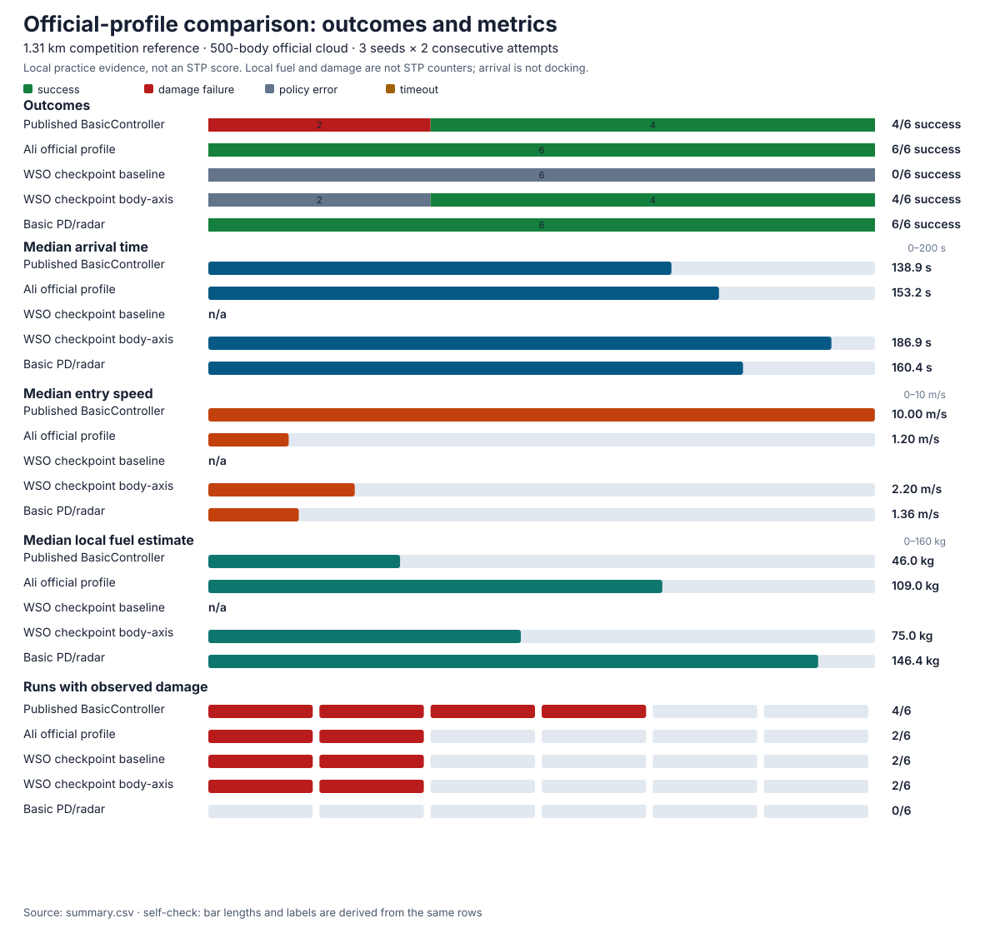

# Official-profile comparison

This comparison runs on the local **Competition reference · 1.31 km hop** preset
with the **Official debris cloud**. It is a local practice comparison, not an STP
submission, leaderboard result or licensed-runtime measurement.

The historical [teammate comparison](../README.md#recorded-teammate-flights) is
separate: it used the older broad-stream world. This page covers the official
relative geometry, a local cloud with a fixed 500-body count and the published
example controller.

The published run predates the owner designation and labels the same policy
`wso_official_profile`. The current entrypoint is
[`ali_official_profile`](../examples/ali/official_profile.py); the old sweep key
remains an alias so the published configuration still reproduces.

## Policies

| Policy | What it is | Source |
| --- | --- | --- |
| `official_basic_beeline` | The published `BasicController.py` behaviour: 10 m/s goal velocity, unity translation gain, body +X alignment, no debris avoidance | [`BasicController.py`](https://github.com/SimDynamX/STU4-Solution/blob/8545c085426a71c39cbe1d544a844b3edb757007/BasicController.py) |
| `ali_official_profile` (published as `wso_official_profile`) | Ali's official-profile beeline with fresh-radar potential avoidance and a current-lease sweep. This is the policy used by the official-profile arrival regression | `src/wsorb/controllers/official_profile.py`, `src/wsorb/flight/official_profile.py` |
| `baseline` | WSO's existing portable checkpoint controller | `src/wsorb/stp_policy.py` |
| `body-axis` | The same checkpoint controller with body-axis candidate preference | `src/wsorb/stp_policy.py` |
| `basic_pd_radar` | The older simple position/velocity PD with short-range radar repulsion, used as a local reference | `src/wsorb/flight/control.py` |

The official baseline deliberately has no debris avoidance. An arrival by that
policy is not evidence that its path was safe or that it would reproduce in the
licensed runtime.

## Matched conditions

- Preset: `competition_reference`, 1,305.8 m target, 50 m arrival region.
- Debris: `official_cloud`, 500 physical bodies, seed 100 in the published source.
- Seeds: 100, 101 and 102, with two consecutive unchanged-code repetitions per
  seed and policy.
- Horizon: 300 s; controller step 0.5 s; physics step 0.05 s.
- Caps: 0.5 m/s² linear and 0.05 rad/s² angular.
- Every attempt starts a fresh world; no debris count, speed, size or noise is
  reduced.
- Radar is the 200-of-500 rolling official scan, including each row's own
  acquisition timestamp. No hidden debris state is supplied to a policy.

Two repetitions per seed mirror the rules' consecutive-pair idea, but the local
averaging is descriptive. The local generator uses the requested seeds 100, 101
and 102; repeats of a seed reuse its deterministic population. This is a small
three-seed sample, not six independent reliability draws. The official script
hardcodes seed 100, but matching that number does not make the local and STP
populations identical. See [seed and generator differences](competition-reference.md#remaining-local-differences).

## Results

The per-trial records and summary are the published result:

- [Metric dashboard](analytics/official-comparison/performance.svg)
- [Hosted read-only comparison workspace](https://western-sydney-orbital-api.western-sydney-orbital-worker.workers.dev/compare.html)
- [Curated ownship paths](analytics/path-comparison/official.json)
- [Trace-derived per-trial metrics CSV](analytics/path-comparison/official-trials.csv)
- [Per-trial CSV](analytics/official-comparison/runs.csv)
- [Summary CSV](analytics/official-comparison/summary.csv)
- [Configuration](analytics/official-comparison/configuration.json)
- [Policy source record](analytics/official-comparison/policies.json)
- [Artifact checksums](analytics/official-comparison/manifest.json)

The full interactive report is not committed because it embeds raw public
observation traces. Regenerate it locally with `just flight-analyze` from a
saved run.

The archived `runs.csv` has zero sample counts and blank per-trial metrics even
though the saved traces contain real observations. It remains unchanged for
provenance. Use the separate trace-derived CSV for per-trial measurements. The
path publication recomputes finals from the saved observations and checks the
group metrics against the original summary. Blank archive cells are not zeros.

Across six attempts per policy (three seeds, two consecutive attempts each):

| Policy | Arrivals | Outcomes | Median arrival, s | Median final speed, m/s | Median local fuel, kg | Runs with damage |
| --- | ---: | --- | ---: | ---: | ---: | ---: |
| Published `BasicController` baseline | 4/6 | 4 success, 2 damage failures | 138.9 | 10.00 | 46.0 | 4/6 |
| Ali official profile (published as `wso_official_profile`) | 6/6 | 6 success | 153.2 | 1.20 | 109.0 | 2/6 |
| WSO checkpoint `baseline` | 0/6 | 6 policy-ineligible | — | — | — | 2/6 |
| WSO checkpoint `body-axis` | 4/6 | 4 success, 2 policy-ineligible | 186.9 | 2.20 | 75.0 | 2/6 |
| Basic PD/radar | 6/6 | 6 success | 160.4 | 1.36 | 146.4 | 0/6 |



Arrival-time medians use successful runs only. Final-speed and fuel medians use
physical outcomes, including damage failures. They are separate distributions,
not measurements from one representative flight. These archive values remain
unchanged.

The hosted workspace's efficiency summaries use
arrivals only; context summaries use available readings from all attempts in the
outcome filter. Its paired Δ is the median of individual seed/repetition-matched
differences, not a difference of medians. Efficiency Δ requires both runs to have
arrived. Trial rows retain failure and partial-error readings, with counts and
spread reported per metric. These summaries need not equal the archived table.

The published baseline has the shortest successful-arrival median, but enters the
arrival region at about 10 m/s and both seed-102 attempts failed the 209,200 J damage threshold
(209,326 J). Ali's official profile arrived on every attempt and entered at
about 1.2 m/s; it observed 49,464 J on seed 101 but stayed below the threshold,
and used more fuel than the baseline. Basic PD also arrived on every attempt, but
later and with more local fuel. The checkpoint profiles were less reliable on
this field. Every checkpoint `baseline` attempt eventually ended in a policy
eligibility error, after 75.5 s on seed 100, 127 s on seed 101 and 115.5 s on seed
102. Both repetitions retained those partial flights. The trace-derived CSV
preserves their range, speed, fuel and damage readings; they are not arrivals.
The `body-axis` profile arrived on seeds 100 and 102 and ended in a policy
eligibility error at 78 s on seed 101. Those are real policy outcomes, not hidden
retries.

Completion means native mission success and entry to the 50 m arrival region.
It is not a docking or low-speed rendezvous claim. Damage, local fuel, time and
relative speed are recorded separately. Errors and timeouts stay in the attempt
counts; they are not silently replaced by a successful seed.

The revised browser comparison calculates points with the current published
formula on recorded local terminal time, damage, fuel and distance inputs.
These are local estimates, not STP receipts. Current upstream fuel includes both
elapsed time and mass, unlike the older actuator pin. The remaining differences
include individual jet allocation and angular fuel, the unpublished damage
Blueprint and asynchronous scorer timing. See the [current scoring analysis](scoring.md).
The archived score fields, physical measurements and artifact checksums stay unchanged.

## Repeat it

```sh
just build
just flight-sweep examples/official_comparison.json runs/official-comparison-new
just official-chart
```

`just official-chart` regenerates the SVG from the committed `summary.csv` and
updates its hash in the artifact manifest.

The output directory must be new. The sweep records the engine build, public
policy sources, configuration and every trial trace in that directory. To
regenerate the HTML from saved trials, run:

```sh
just flight-analyze runs/official-comparison-new
```

To inspect a specific repetition without replacing its saved report, provide a
new HTML file as the third argument:

```sh
just flight-analyze runs/official-comparison-2026-11-02 trial-00012 runs/seed-101-review.html
```

The new report reads existing traces only. It refuses an existing output file.
Its path coordinates use the same fixed basis as the hosted workspace, and its
command segments retain their actual preceding intervals.

## Inspect a path adjustment

The [hosted read-only comparison workspace](https://western-sydney-orbital-api.western-sydney-orbital-worker.workers.dev/compare.html)
now includes the matrix, scatter plot and interval inspector for the saved
flights. It does not start a flight, load the game engine or need WebGPU.

### Use the hosted workspace

The controls described here were deployed on 3 November 2026. Archived flight measurements remain unchanged.

Choose a world above the Summary matrix. **Filters** contains outcome, inspected
seed/repetition, baseline and **Show differences from baseline**. Differences are
off initially; the switch applies to matrix values and timelines together. The
worlds never share a metric comparison. Cursor and interval changes do not alter
whole-flight matrix or scatter values.

- Select a row name to inspect only that controller, or use its checkbox to add
  or remove its actual source runs. Only the baseline is selected initially.
  **Columns** changes metrics; closed **Metric details** holds counts, paired
  coverage, raw readings and provenance. **Trials** shows the current
  seed/repetition pair. **Summary** groups the outcome-filtered attempts by
  controller, with arrivals-only efficiency medians and all-attempt context.
- **Points** is the first numeric column. **Metric details** shows its time or
  remaining-distance term, damage penalty, fuel penalty, offset and total. Trial
  points use each run's recorded terminal inputs. Summary points are the mean of
  complete two-run pair scores, calculated from individual run scores rather than
  median time, damage or fuel. Terminal damage failures can contribute; missing
  inputs, unfinished runs and errors remain unavailable, never zero. Coverage,
  incomplete pairs and attempt/error counts remain visible. These are labelled
  current-formula local estimates, not newly observed official results. The
  [175-point example](scoring.md#how-175-points-is-possible) is hypothetical.
  Failure distance uses the actual saved time-zero target range, never preset
  geometry or the current engine; a missing initial reading leaves points unavailable.
  Point differences from baseline average complete matched pair-score differences,
  with both repetitions available for both profiles. Point components use that
  same mean reduction; other metrics retain their median paired Δ.
- Open **Explore trade-offs** to choose scatter axes and select points or a range. Selection follows
  actual source run IDs, even in Summary. A single point opens its seed and
  repetition. In Trials, changing the pair maps selected controller identities to
  its actual runs; Summary retains the selected source IDs. A multi-pair
  selection does not merge trajectories.
- **Flight path** shows the two actual path projections first. Open **Inspect
  time** for cursor, interval and track controls, or select a graph point to
  inspect it. Interval endpoint totals appear only after selecting an interval.
  The inspector shows selected runs in the current seed/repetition pair plus
  their baseline. If that pair contains no selected run, it stays empty rather
  than substituting another trial. Compare interval endpoint changes, alignment
  and baseline differences with both path projections. It never overlays
  different seed/repetition pairs or treats an aggregate as a flight.
- Use equal map scale before judging angles. Detail scale makes small detours
  visible but distorts them. Radar range is not hull clearance or collider identity.

`Data & method` contains limitations and source hashes. `Export data` contains
the world JSON, selected actual-run samples CSV and theory reference.
Both official and historical-team metric supplements are hosted. They use
existing saved receipts, not new flights. Missing native data remains null;
commands never substitute for burn or turn counters. Saved path measurements
remain usable if a supplement cannot load. The published source-engine hashes
and measurements do not change when the live game's defaults or engine change.

The maps use a fixed basis from the first launch position to the first target
position. Lateral and normal are two perpendicular offsets, not altitude or
ship axes. No raw radar, images, private descriptors or unobserved debris states
are published. Downloads include source hashes and actual timestamps. Missing
samples stay missing; a stopped trace is never extended to the cursor time.

The old sweep records a command with the observation **after** applying it.
Command row `t` therefore describes the preceding interval, not a request that
starts at `t`. Damage brackets also describe sampled intervals, not exact contact
times. These plots support an optimisation hypothesis, not collision replay.

To publish paths from saved evidence without flying again:

```sh
just path-comparison runs/official-comparison-2026-11-02 official
just path-comparison runs/teammate-analytics-69 team
```

The hosted metric supplements were generated from saved receipts without
rerunning flights. To reproduce their publication:

```sh
just comparison-metrics runs/official-comparison-2026-11-02 official
just comparison-metrics runs/teammate-analytics-69 team
```

Historical summaries and original publications remain unchanged. The curated
trajectory files form a separate, checksummed publication. The [Python theory
review](python-flight-theory.md) maps the script to the actual controller and
explains PID, filtering, forecasting and local/STP differences.

The hosted copy of the historical legacy-score SVG has a wider viewport so its
long negative tick label is visible. Its values and the archived source SVG stay
unchanged. New SVG generation reserves more label space at the axis.

## Limits

- Local terrain, absolute frame, gravity, contacts, fuel and damage differ from
  the licensed mission. The preset ports the relative 1,305.8 m geometry onto
  the local far-side site.
- The official baseline's attitude command is represented by the same bounded
  shortest-arc law used by Ali's official profile, so this comparison isolates
  translation and avoidance rather than claiming a line-by-line port of the
  example's torque loop.
- The checkpoint profiles are older WSO controllers. Their behaviour here does
  not describe Ali's official-profile policy or the official baseline.
- No result on this page is a competition score, a safety certificate or an STP
  leaderboard position.
